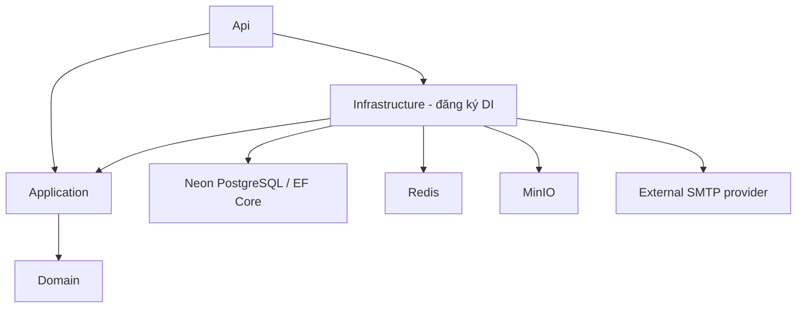
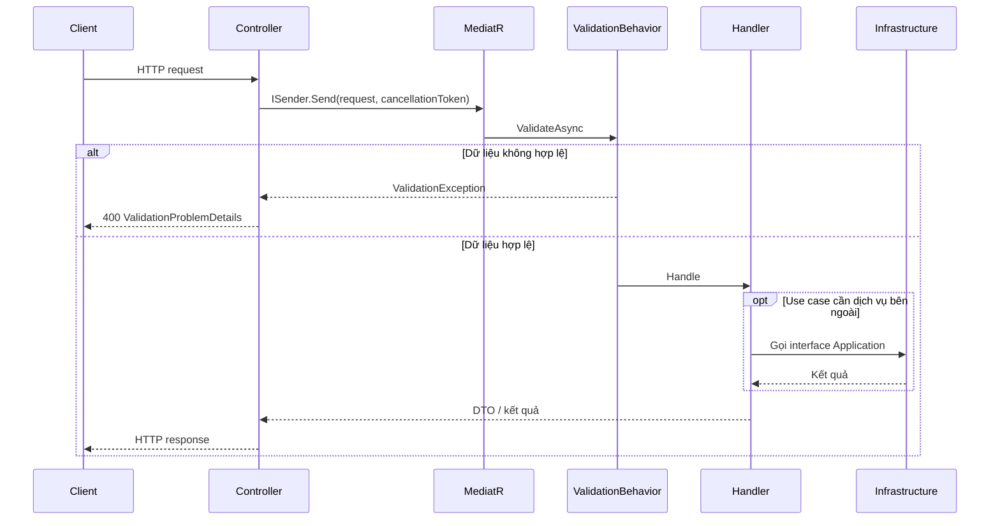

# Clean Architecture

Backend là một ứng dụng ASP.NET Core, triển khai như một khối thống nhất. CQRS tách command (ghi/thực hiện hành động) và query (đọc) trong cùng ứng dụng; hiện vẫn dùng một database Neon. MediatR điều phối request trong process, không phải message broker.

## Chiều dependency



Mũi tên giữa project biểu diễn dependency khi biên dịch. Domain không tham chiếu project khác hoặc NuGet package. Application chỉ tham chiếu Domain; Infrastructure triển khai interface do Application định nghĩa. API tham chiếu Infrastructure để đăng ký DI trong `Program.cs`; controller gọi Application qua `ISender`.

| Project        | Đặt code ở đây                                                               | Ranh giới                                                       |
| -------------- | ---------------------------------------------------------------------------- | --------------------------------------------------------------- |
| Domain         | Entity, value object, quy tắc nghiệp vụ                                      | Độc lập với ASP.NET, EF Core và các adapter                     |
| Application    | Command/query, handler, validator, DTO, interface                            | Không dùng DbContext, HTTP context hoặc client Redis/MinIO/SMTP |
| Infrastructure | DbContext, EF configurations/migrations, adapter dữ liệu/cache/storage/email | Triển khai interface Application                                |
| Api            | Controller, HTTP request/response, mapping HTTP, exception handler, DI       | Không xử lý nghiệp vụ hoặc truy cập DbContext trong controller  |

## Luồng request



`ValidationBehavior` chạy validator bất đồng bộ và tuần tự trước handler. Cách này hỗ trợ `MustAsync` và tránh chạy đồng thời nhiều validator dùng chung scoped DbContext. Request và validator phải truyền tiếp cancellation token. Lỗi được gom theo property vào `errors`; ProblemDetails có `traceId` để tra log.

## Tổ chức use case

```text
Application/
  Common/Behaviors/ValidationBehavior.cs
  DependencyInjection.cs
  Email/
    IMailSender.cs
    Commands/SendEmail/
      SendEmailCommand.cs
      SendEmailCommandValidator.cs
  System/Queries/GetSystemStatus/
    GetSystemStatusQuery.cs
Api/
  Controllers/
  Mapping/SystemProfile.cs
  ExceptionHandling/ValidationExceptionHandler.cs
```

Khi thêm tính năng, tạo thư mục theo nghiệp vụ, ví dụ `Exams/Commands/SubmitExam` hoặc `Exams/Queries/GetExam`. Mỗi use case chứa request, handler, DTO và validator cần thiết; có thể tách ra các file riêng khi code dài hơn.

1. Đặt quy tắc nghiệp vụ và entity trong Domain.
2. Tạo command/query dùng `IRequest<TResponse>` và handler dùng `IRequestHandler<TRequest, TResponse>` trong Application.
3. Với dữ liệu đầu vào, tạo `AbstractValidator<TRequest>`. DI tự phát hiện handler, validator và mapping profile trong Application.
4. Nếu cần database hoặc dịch vụ bên ngoài, định nghĩa interface theo use case trong Application và triển khai trong Infrastructure. Đăng ký implementation tại `AddInfrastructure`.
5. Controller chuyển HTTP request thành command/query, gọi `ISender.Send` và trả HTTP response.
6. Bổ sung test cho quy tắc nghiệp vụ, dữ liệu sai và các side effect cần kiểm soát.

Mẫu đọc hiện có: `GET /api/v1/system/ping` → `GetSystemStatusQueryHandler` → `SystemStatusDto` → `SystemProfile` → `PingResponse`. Contract FE vẫn là `{ "service": "TOEICMaster", "status": "ok" }`.

Mẫu command hiện có: `SendEmailCommand` → `SendEmailCommandValidator` → `SendEmailCommandHandler` → `IMailSender` → `SmtpMailSender`. Command này phục vụ use case nội bộ và tests; chưa có HTTP endpoint gửi mail. Giới hạn hiện tại là recipient 254 ký tự, subject 200 ký tự và text body 100.000 ký tự.

## Thư viện và quy ước

- **MediatR:** dùng `ISender` trong controller để gửi command/query. CQRS là pattern, không có package riêng bắt buộc.
- **FluentValidation:** dùng core package và DI extensions; validation nằm trong MediatR pipeline. Không dùng `FluentValidation.AspNetCore` auto-validation vì pipeline MVC không hỗ trợ async và package đó đã ngừng được duy trì. [Hướng dẫn chính thức](https://docs.fluentvalidation.net/en/latest/aspnet.html).
- **AutoMapper:** profile Domain → Application DTO đặt trong Application; profile Application DTO → HTTP response đặt trong Api. DI scan cả hai assembly. Map vào entity có quy tắc nghiệp vụ phải đi qua constructor/method của entity để bảo vệ trạng thái; không map input tùy ý vào entity.
- **EF Core:** DbContext, configuration và migration nằm trong Infrastructure. Query chỉ đọc nên dùng `AsNoTracking`, phân trang và chỉ lấy trường cần thiết. Tạo interface truy cập dữ liệu theo nghiệp vụ khi có use case; không thêm generic repository hoặc transaction behavior toàn cục khi chưa xác định ranh giới transaction.

AutoMapper đã tích hợp `AddAutoMapper`; MediatR đã tích hợp `AddMediatR`. Không cài thêm các package `*.Extensions.Microsoft.DependencyInjection` cũ. [AutoMapper DI](https://docs.automapper.io/en/stable/Dependency-injection.html), [MediatR DI](https://github.com/LuckyPennySoftware/MediatR#registering-with-iservicecollection).

## Kiểm thử và cấu hình

Test project được chia thư mục theo cùng ranh giới Clean Architecture: `Architecture`, `Application`,
`Infrastructure` và `Api`. Fake dùng chung nằm trong `TestDoubles` để test case không phụ thuộc lẫn nhau qua namespace
gốc. Tests kiểm tra project references, dependency của Domain/Application, dispatch và validation qua MediatR,
cancellation, HTTP ProblemDetails, mapping configuration, contract ping, CORS và SMTP adapter. Tests dùng mail adapter
giả hoặc SMTP server local; không cần credential Neon thật.

Credential Neon và license key nằm trong user secrets hoặc environment. Xem README để setup. DI không đưa license key vào HTTP response hoặc log và không tắt cảnh báo license của thư viện.

Luồng đăng ký tài khoản đặt `RegisterCommand`, `VerifyEmailCommand` và `ResendEmailVerificationCommand` trong
Application. `User` và `EmailVerificationChallenge` nằm trong Domain; adapter EF/BCrypt/HMAC/SMTP nằm trong
Infrastructure. Tài khoản local bắt đầu ở trạng thái chưa kích hoạt; PostgreSQL chỉ lưu HMAC của OTP 6 số, số lần sai,
thời hạn và cooldown gửi lại. Đăng nhập dùng `LoginCommand`; JWT và random refresh token được cấp bởi adapter Infrastructure. Domain
quản lý `UserSession`, còn PostgreSQL chỉ lưu hash của refresh token. Refresh thực hiện rotation trong transaction với
conditional update để một token không thể được dùng thành công hai lần đồng thời. API cấu hình Bearer authentication và
chỉ chuyển request vào MediatR, ánh xạ lỗi sang ProblemDetails.

JWT hiện chỉ chứa identity claim, chưa chứa role. Mô hình role và permission cần được xác định theo nghiệp vụ;
không gán role mặc định tùy ý trong token. API danh sách tài khoản áp dụng policy `AccountAdministration` yêu cầu Admin,
nên token đăng nhập thông thường nhận `403` cho đến khi module phân quyền cấp role phù hợp.
Access token ngắn hạn không có cơ chế blacklist;
logout thu hồi refresh session và access token cũ tự hết hạn sau tối đa 15 phút.

Đăng nhập Google nhận ID token đã ký, adapter `GoogleIdentityVerifier` kiểm tra token bằng Web Client ID cấu hình cho môi
trường. `external_identities` lưu khóa ổn định `(provider, subject)` và tham chiếu `users`; email chỉ dùng để tạo hoặc cân
nhắc liên kết tài khoản, không phải định danh Google. Tài khoản Google-only có `PasswordHash = null` và không thể đăng
nhập local cho đến khi có use case đặt mật khẩu riêng.

Việc liên kết tự động với user có sẵn chỉ được phép cho Gmail hoặc Google Workspace. Email bên thứ ba cần một luồng liên
kết đã xác thực phiên local để tránh takeover. Repository xử lý unique constraint của email và `(provider, subject)` để
hai lần đăng nhập Google đầu tiên chạy đồng thời vẫn hội tụ về một user.

[API danh sách tài khoản](account-list-api.md) gọi `GetAccountsQuery` qua MediatR và đọc `users` qua `IAccountReader`.
Projection trả `DisplayName`, `CreatedAtUtc` cùng thông tin cơ bản; không đọc password hash hoặc truy cập bảng role.
