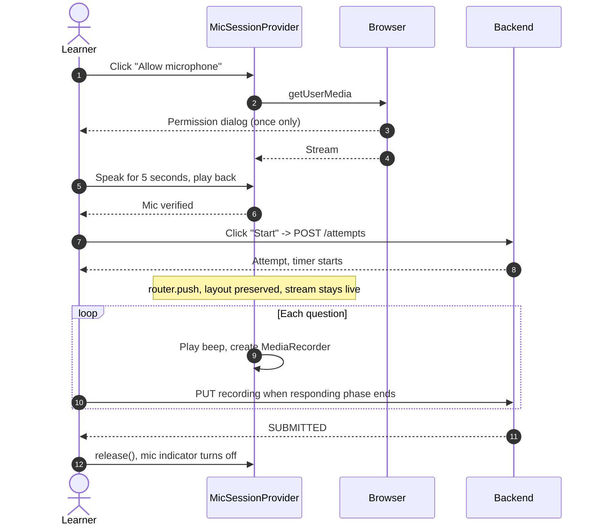

# ADR-003: Single Microphone Session per Speaking Attempt

## Status

Implemented on 2026-11-21; device and permission UAT across the browser matrix is still pending.

## Date

2026-11-03

## Context

Requirement: learners grant microphone permission only once, then complete the test continuously.

The implementation uses `status = ready` together with a `verified` flag for the check result.
The provider owns the stream and AudioContext; the hook only owns the MediaRecorder/recordings.
FULL tests must complete all three steps; Part practice offers a separate non-recording button.
On page reload, restoration is only attempted if the permission query returns `granted`; unknown permission states require user interaction.

Currently, the check screen (`/speaking/tests/[id]/practice`, `/speaking/exercises/[id]/practice`) and the test-taking screen (`/speaking/attempts/[id]`) each create their own `useVoiceRecorder`.
When navigating between screens, the first stream is stopped and the next screen calls `getUserMedia` again.
This second call happens **after** the server has already created the attempt, so the timer is already running.
The attempt route is also the review screen, so submitted tests still prompt for microphone access.
Details are documented in MIC-01 through MIC-11 in the [audit report](../runbooks/speaking-audit-report.md).

**Platform limitations.** Permissions belong to the browser and the user; a website cannot force "allow forever":

- Chrome has an ["Allow this time"](https://developer.chrome.com/blog/one-time-permissions) option: the next visit prompts again, and permission can expire back to `prompt`.
- [MDN documentation](https://developer.mozilla.org/docs/Web/API/MediaDevices/getUserMedia) explicitly notes that browsers may grant permission per session or per domain.
- Safari sources ([W3C 2019](https://lists.w3.org/Archives/Public/public-webrtc-logs/2019Oct/0176.html), [Apple Forums 2025](https://developer.apple.com/forums/thread/788518)) suggest it may prompt per document, though these sources are dated or unconfirmed and must be measured in practice.

Therefore, the system's guarantee is defined as follows:

> **Within a single attempt, the application requests permission only once, before the attempt is created. Afterward, the application will never trigger another permission dialog on its own, unless the learner clicks a button, or the page is reloaded and the browser has forgotten the permission.**

## Decision

### 1. Keep the stream in a layout-level provider

Add `src/app/speaking/layout.tsx` wrapping `MicSessionProvider`.
Next.js preserves layouts across `router.push` navigations within `/speaking/*`, so the stream survives the transition from the check screen to the attempt screen.

Split the existing hook into two parts:

| File in `src/features/speaking/` | Responsibility |
| :--- | :--- |
| `mic/mic-session-provider.tsx` (new) | Owns `MediaStream`, `AudioContext`, permission state, and selected device. **The only place that calls `getUserMedia`.** |
| `hooks/use-voice-recorder.ts` (modified) | Only creates `MediaRecorder` on the provider's stream; manages recordings per question. |

```ts
interface MicSession {
  status: MicStatus;
  level: number;
  devices: MediaDeviceInfo[];
  /** Only call from a user gesture. Calling again while the stream is live does not prompt for permission. */
  acquire(deviceId?: string): Promise<boolean>;
  /** Only called when query returns "granted", so it cannot trigger a dialog. */
  restoreIfGranted(): Promise<boolean>;
  release(): void;
}

type MicStatus =
  | "idle" | "requesting" | "ready" | "verified" | "lost"
  | "denied" | "no-device" | "busy" | "insecure" | "unsupported";
```

`ready` keeps its existing name so `RecorderStatus` and `MicCheckPanel` require minimal changes.
`verified` and `lost` are only needed when implementing the PRD-aligned pass (sections 6 and 4).

**Implementation details to preserve, drawn from the prototype:**

- The effect on the attempt screen must wait until the attempt finishes loading: `IN_PROGRESS` calls `restoreIfGranted()`, `SUBMITTED` calls `release()`. Do not run an effect immediately on mount as currently implemented.
- The provider automatically calls `release()` when `usePathname()` leaves `/speaking/tests/*/practice`, `/speaking/exercises/*/practice`, `/speaking/attempts/*`. Without this step, clicking "Back" to `/speaking` keeps the mic open because the layout is not unmounted.
- `recordings` remain in the per-attempt hook, not lifted to the provider, so recordings do not leak across attempts.
- Final recording: `recorder.stop()` runs before `release()` because the responding-phase cleanup effect runs before the state-driven effect. Must be verified on a real browser to ensure the final recording contains full audio data.
- The banner in `speaking-attempt.tsx` must also handle `idle` (button to re-enable mic) and the new error states. The prototype did not implement this part.

### 2. Mandatory rules

| # | Rule | Fixes |
| :--- | :--- | :--- |
| R1 | Across the entire Speaking module, only the provider may call `getUserMedia`. | MIC-01 |
| R2 | `acquire` must be idempotent: if a `live` track exists, return immediately; if pending, share the promise. React StrictMode must not trigger two requests. | MIC-01 |
| R3 | Never prompt for permission on mount. Only request on user click, or restore after `permissions.query` returns `granted`. | MIC-03 |
| R4 | Mandatory sequence: permission granted -> audio check -> `POST /attempts` -> `router.push`. | MIC-02 |
| R5 | `SUBMITTED` attempt: do not request mic; call `release()` immediately on submission. Leaving the check or attempt screen must also call `release()`. | MIC-03 |
| R6 | Keep the stream alive between questions; only create and stop `MediaRecorder`. Do not stop tracks between questions. | MIC-01 |
| R7 | `permissions.query` must be wrapped in `try/catch` because [the promise may reject](https://developer.mozilla.org/docs/Web/API/Permissions/query). Errors are treated as unknown, not denied. | MIC-06 |
| R8 | Each error has its own state and guidance (table in section 4). | MIC-06 |

"Mic off" in Phase 1 of the PRD means **not recording**.
The browser's microphone indicator remains lit throughout the test because the stream is kept open to avoid re-prompting.
The check screen must state this clearly.
No audio is recorded or transmitted outside the responding phase.

### 3. Flow



### 4. Scenarios

| Scenario | State | Behavior |
| :--- | :--- | :--- |
| Permission denied (`NotAllowedError`) | `denied` | Guide user to open site settings. See policy in section 5. |
| No microphone (`NotFoundError`) | `no-device` | Ask user to plug in a microphone, with a retry button. Do not mention "grant permission". |
| Microphone used by another app (`NotReadableError`) | `busy` | Ask user to close the app currently using the microphone. |
| Page served without HTTPS (`navigator.mediaDevices` is `undefined`) | `insecure` | Report deployment error. Do not say "browser not supported". |
| No `MediaRecorder` | `unsupported` | Suggest switching browsers. |
| Reload, query returns `granted` | auto-restore | Call `restoreIfGranted()`, no dialog. |
| Reload, query returns `prompt` or unsupported | `idle` | Show overlay: "The timer is still running. Click to re-enable microphone." Only request permission on click. |
| Microphone unplugged mid-test (`track.ended`, `recorder.onerror`) | `lost` | Show immediate warning; if permission still holds, try restoring. Server timer does not stop. |
| Reload during responding phase | | In-progress recording is lost. Add `beforeunload` during this phase. On reopen, report which questions have no recording. |

The server timer never stops for microphone errors, preserving fairness and existing `AdvanceExpired` logic.

### 5. Policy when no microphone is available

| Mode | When check fails |
| :--- | :--- |
| Full test (`FULL`) | Disable the start button, matching AC-SPEAK-01. |
| Part practice | Show an additional secondary button "Practice without recording". This attempt cannot be AI-graded: consent already returns `409` when no recording exists. |

No backend change is required because the server cannot verify microphones itself.
If someone bypasses the UI, questions simply receive `NO_RECORDING` and 0 points.
This policy is proposal D1, awaiting approval.

### 6. Device check (3 steps per PRD 4.3.2.A)

1. **Grant permission:** "Allow microphone" button. Call `enumerateDevices` only after permission is granted, because browsers may hide device labels beforehand. Display the microphone selector list per Figma 20.
2. **Test speaking:** record 5 seconds of "Hello, I am ready for the TOEIC Speaking test." and display the audio level. Pass when `level >= 0.15` for at least 1 second total. This is an initial threshold and should be calibrated during UAT.
3. **Playback:** play back the recording and ask "Can you hear clearly?". This step checks both speaker and microphone in one action. The approach is similar to [Cambridge's system test](https://auto-metrica.cambridgeenglish.org/metrica/systemTest.aspx).

`AudioContext` is created or `resume()`d directly inside the Step 1 click handler, then shared for the volume meter and beep (MIC-09).

### 7. Beep sound

Generated with `OscillatorNode` on the shared `AudioContext`, requiring no audio file.
Approximately 1 kHz, 300 ms.
Upon entering `RESPONDING`: finish playing the beep before starting `MediaRecorder`, so the beep does not bleed into the recording sent for grading.

## Alternatives considered

### Rely on the browser remembering permission (current state)

- Pros: no changes required.
- Cons: cannot guarantee behavior with one-time permission or on Safari; does not solve prompting on the review screen.
- Rejected.

### Merge the check screen and attempt screen into one route

- Pros: no new layout needed.
- Cons: the attempt does not exist yet during the check, so the URL would have to change mid-flow; resume and review still need an `attemptId` route.
- Rejected.

### Module-level global variables

- Pros: very little code.
- Cons: hard to test, hard to clean up resources, easy to leave the mic active after leaving the page.
- Rejected. A provider gives a clear lifecycle.

### Create the attempt first and pause the timer until the mic is ready

- Pros: fairer on page reload.
- Cons: requires modifying the Domain state machine and adding new states, while R4 already handles the primary case.
- Rejected.

## Consequences

- The prototype verified sections 1 and 2 (see [report section 0](../runbooks/speaking-audit-report.md#0-re-verification-results-2026-11-03)): 106-line provider, 1 layout, 3 modified files. Tests mocked route transitions; not yet run on Next.js and real browsers.
- FE changes only. Backend, API, and database remain unchanged.
- New files added only under `src/app/speaking/` and `src/features/speaking/`. No other modules touched.
- `mic-check-panel.test.tsx` must be rewritten because states changed; tests for R1-R5 must be added.
- The browser mic indicator staying lit throughout the test is an accepted trade-off.
- Cannot guarantee "never prompt again" across page reloads. Per-browser results are recorded in the [UAT runbook](../runbooks/speaking-uat-runbook.md#3-microphone-permission-matrix).
- Deployment environments must use HTTPS, except `localhost`.
