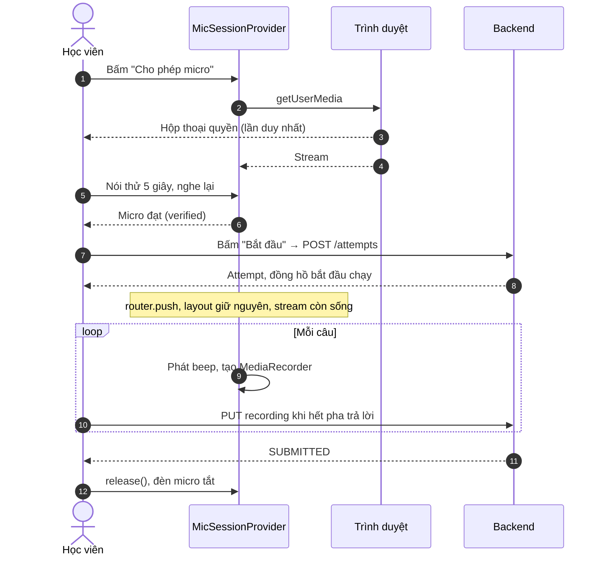

# ADR-003: Một phiên micro duy nhất cho mỗi lượt làm Speaking

## Status

Proposed (chờ chủ tính năng duyệt; chưa triển khai)

## Date

2026-11-03

## Context

Yêu cầu: học viên chỉ cấp quyền micro một lần, rồi làm bài liên tục.

Hiện tại màn kiểm tra (`/speaking/tests/[id]/practice`, `/speaking/exercises/[id]/practice`) và màn làm bài (`/speaking/attempts/[id]`) mỗi màn tạo một `useVoiceRecorder`. Khi chuyển màn, stream đầu bị dừng và màn sau gọi `getUserMedia` lần nữa. Lần gọi này xảy ra **sau khi** server đã tạo lượt làm, nên đồng hồ đã chạy. Route làm bài cũng là màn xem lại, nên bài đã nộp vẫn xin micro. Chi tiết ở MIC-01 đến MIC-11 trong [báo cáo rà soát](../runbooks/speaking-audit-report.md).

**Giới hạn của nền tảng.** Quyền thuộc về trình duyệt và người dùng, website không thể ép "cho phép vĩnh viễn":

- Chrome có lựa chọn ["Allow this time"](https://developer.chrome.com/blog/one-time-permissions): lần sau sẽ hỏi lại, và quyền có thể hết hạn về `prompt`.
- Tài liệu [MDN](https://developer.mozilla.org/docs/Web/API/MediaDevices/getUserMedia) ghi rõ trình duyệt có thể cấp quyền theo phiên hoặc theo domain.
- Nguồn về Safari ([W3C 2019](https://lists.w3.org/Archives/Public/public-webrtc-logs/2019Oct/0176.html), [Apple Forums 2025](https://developer.apple.com/forums/thread/788518)) cho thấy có thể hỏi theo từng document, nhưng các nguồn này cũ hoặc chưa được xác nhận, nên phải đo thực tế.

Vì vậy, cam kết của hệ thống được định nghĩa như sau:

> **Trong một lượt làm, ứng dụng chỉ yêu cầu quyền một lần, trước khi lượt làm được tạo. Sau đó ứng dụng không tự gây ra hộp thoại quyền nào nữa, trừ khi học viên bấm nút, hoặc khi trang bị tải lại và trình duyệt đã quên quyền.**

## Decision

### 1. Giữ stream trong provider ở cấp layout

Thêm `src/app/speaking/layout.tsx`, bọc `MicSessionProvider`. Next.js giữ nguyên layout khi điều hướng bằng `router.push` trong `/speaking/*`, nên stream sống qua lần chuyển từ màn kiểm tra sang màn làm bài.

Tách hook hiện có thành hai phần:

| File trong `src/features/speaking/` | Trách nhiệm |
| :--- | :--- |
| `mic/mic-session-provider.tsx` (mới) | Sở hữu `MediaStream`, `AudioContext`, trạng thái quyền, thiết bị đang chọn. **Nơi duy nhất gọi `getUserMedia`.** |
| `hooks/use-voice-recorder.ts` (sửa) | Chỉ tạo `MediaRecorder` trên stream của provider; quản lý bản ghi theo câu. |

```ts
interface MicSession {
  status: MicStatus;
  level: number;
  devices: MediaDeviceInfo[];
  /** Chỉ gọi từ thao tác người dùng. Gọi lại khi stream còn sống thì không xin quyền. */
  acquire(deviceId?: string): Promise<boolean>;
  /** Chỉ gọi khi query trả "granted", nên không thể làm hiện hộp thoại. */
  restoreIfGranted(): Promise<boolean>;
  release(): void;
}

type MicStatus =
  | "idle" | "requesting" | "ready" | "verified" | "lost"
  | "denied" | "no-device" | "busy" | "insecure" | "unsupported";
```

`ready` giữ nguyên tên hiện có, để `RecorderStatus` và `MicCheckPanel` đổi ít nhất. `verified` và `lost` chỉ cần khi làm đợt đúng PRD (mục 6 và mục 4).

**Chi tiết cần giữ khi triển khai, rút ra từ prototype:**

- Effect ở màn làm bài phải chờ tải xong attempt: `IN_PROGRESS` thì `restoreIfGranted()`, `SUBMITTED` thì `release()`. Không dùng effect chạy ngay lúc mount như hiện nay.
- Provider tự `release()` khi `usePathname()` ra khỏi các route `/speaking/tests/*/practice`, `/speaking/exercises/*/practice`, `/speaking/attempts/*`. Nếu thiếu bước này, bấm "Quay lại" về `/speaking` vẫn giữ micro vì layout không bị hủy.
- `recordings` vẫn ở hook theo từng lượt làm, không đưa lên provider, để bản ghi không lẫn giữa các lượt.
- Bản ghi cuối: `recorder.stop()` chạy trước `release()`, vì effect dọn của pha trả lời chạy trước effect theo trạng thái. Cần xác nhận trên trình duyệt thật rằng bản ghi cuối vẫn đủ dữ liệu.
- Banner ở `speaking-attempt.tsx` phải xử lý thêm `idle` (nút bật lại micro) và các lỗi mới. Prototype chưa làm phần này.

### 2. Quy tắc bắt buộc

| # | Quy tắc | Sửa |
| :--- | :--- | :--- |
| R1 | Toàn module Speaking chỉ có provider được gọi `getUserMedia`. | MIC-01 |
| R2 | `acquire` phải idempotent: có track `live` thì trả ngay; đang chờ thì dùng chung promise. React StrictMode không được tạo hai yêu cầu. | MIC-01 |
| R3 | Không tự xin quyền lúc mount. Chỉ xin khi người dùng bấm, hoặc khôi phục sau khi `permissions.query` trả `granted`. | MIC-03 |
| R4 | Thứ tự bắt buộc: có quyền → kiểm tra âm thanh → `POST /attempts` → `router.push`. | MIC-02 |
| R5 | Attempt `SUBMITTED`: không xin micro; gọi `release()` ngay khi nộp xong. Rời khỏi màn kiểm tra hoặc màn làm bài cũng phải `release()`. | MIC-03 |
| R6 | Giữa các câu giữ nguyên stream, chỉ tạo và dừng `MediaRecorder`. Không dừng track giữa các câu. | MIC-01 |
| R7 | `permissions.query` phải bọc `try/catch` vì [promise có thể bị reject](https://developer.mozilla.org/docs/Web/API/Permissions/query). Lỗi được coi là chưa biết, không phải bị từ chối. | MIC-06 |
| R8 | Mỗi lỗi có một trạng thái và hướng dẫn riêng (bảng mục 4). | MIC-06 |

"Micro tắt" ở Pha 1 trong PRD được hiểu là **không ghi âm**. Biểu tượng micro của trình duyệt vẫn sáng trong suốt bài, vì stream được giữ để tránh xin quyền lại. Màn kiểm tra phải nói rõ điều này. Không có âm thanh nào được ghi hay gửi đi ngoài pha trả lời.

### 3. Luồng



### 4. Các tình huống

| Tình huống | Trạng thái | Hành vi |
| :--- | :--- | :--- |
| Từ chối quyền (`NotAllowedError`) | `denied` | Hướng dẫn mở cài đặt site. Xem chính sách ở mục 5. |
| Không có micro (`NotFoundError`) | `no-device` | Báo cắm micro, có nút thử lại. Không nhắc đến "cấp quyền". |
| Micro bị ứng dụng khác chiếm (`NotReadableError`) | `busy` | Báo đóng ứng dụng đang dùng micro. |
| Trang không có HTTPS (`navigator.mediaDevices` là `undefined`) | `insecure` | Báo lỗi triển khai. Không ghi "trình duyệt không hỗ trợ". |
| Không có `MediaRecorder` | `unsupported` | Báo đổi trình duyệt. |
| Tải lại, query trả `granted` | khôi phục tự động | Gọi `restoreIfGranted()`, không có hộp thoại. |
| Tải lại, query trả `prompt` hoặc không hỗ trợ | `idle` | Hiện lớp phủ: "Đồng hồ vẫn đang chạy. Bấm để bật lại micro." Chỉ xin quyền khi bấm. |
| Rút micro giữa bài (`track.ended`, `recorder.onerror`) | `lost` | Hiện cảnh báo ngay; nếu vẫn có quyền thì thử khôi phục. Đồng hồ server không dừng. |
| Tải lại trong pha trả lời | | Phần đang ghi bị mất. Thêm `beforeunload` trong pha này. Khi mở lại, báo câu nào không có bản ghi. |

Đồng hồ server không bao giờ dừng vì lỗi micro, để giữ tính công bằng và logic `AdvanceExpired` hiện có.

### 5. Chính sách khi không có micro

| Chế độ | Khi không đạt kiểm tra |
| :--- | :--- |
| Đề đầy đủ (`FULL`) | Khóa nút bắt đầu, đúng AC-SPEAK-01. |
| Luyện Part | Hiện thêm nút phụ "Luyện không ghi âm". Lượt này không chấm AI được: consent đã trả `409` khi không có bản ghi. |

Backend không cần đổi vì server không thể tự xác minh micro. Nếu ai đó bỏ qua UI thì câu chỉ nhận `NO_RECORDING` và 0 điểm. Chính sách này là đề xuất D1, chờ duyệt.

### 6. Kiểm tra thiết bị (3 bước theo PRD 4.3.2.A)

1. **Cấp quyền:** nút "Cho phép micro". Sau khi có quyền mới gọi `enumerateDevices`, vì trước đó trình duyệt có thể ẩn nhãn thiết bị. Hiện danh sách chọn micro theo Figma 20.
2. **Nói thử:** ghi 5 giây câu "Hello, I am ready for the TOEIC Speaking test." và hiển thị mức âm thanh. Đạt khi `level ≥ 0,15` trong tổng cộng ít nhất 1 giây. Đây là giá trị khởi đầu, cần hiệu chỉnh trong UAT.
3. **Nghe lại:** phát lại bản vừa ghi và hỏi "Bạn có nghe rõ không?". Bước này kiểm tra cả loa và micro trong một thao tác. Cách làm tương tự [bài kiểm tra của Cambridge](https://auto-metrica.cambridgeenglish.org/metrica/systemTest.aspx).

`AudioContext` được tạo hoặc `resume()` ngay trong thao tác bấm của bước 1, rồi dùng chung cho thanh âm lượng và beep (MIC-09).

### 7. Tiếng beep

Tạo bằng `OscillatorNode` trên `AudioContext` dùng chung, nên không cần tệp âm thanh. Khoảng 1 kHz, 300 ms. Khi vào `RESPONDING`: phát beep xong mới bắt đầu `MediaRecorder`, để tiếng beep không lọt vào bản ghi gửi đi chấm.

## Alternatives considered

### Dựa vào việc trình duyệt tự nhớ quyền (hiện trạng)

- Ưu điểm: không phải đổi gì.
- Nhược điểm: không bảo đảm được khi chọn quyền một lần hoặc trên Safari; không giải quyết việc xin quyền ở màn xem lại.
- Không chọn.

### Gộp màn kiểm tra và màn làm bài thành một route

- Ưu điểm: không cần layout mới.
- Nhược điểm: lượt làm chưa tồn tại lúc kiểm tra, nên URL phải đổi giữa chừng; resume và xem lại vẫn cần route theo `attemptId`.
- Không chọn.

### Biến toàn cục ở cấp module

- Ưu điểm: rất ít code.
- Nhược điểm: khó kiểm thử, khó dọn tài nguyên, dễ để micro sáng sau khi rời trang.
- Không chọn. Provider có vòng đời rõ ràng.

### Tạo lượt làm trước rồi hoãn đồng hồ cho tới khi có micro

- Ưu điểm: tải lại trang công bằng hơn.
- Nhược điểm: phải đổi state machine ở Domain và tạo thêm trạng thái, mà R4 đã xử lý trường hợp chính.
- Không chọn.

## Consequences

- Prototype đã kiểm chứng mục 1 và 2 (xem [báo cáo mục 0](../runbooks/speaking-audit-report.md#0-kết-quả-kiểm-tra-lại-2026-11-03)): provider 106 dòng, 1 layout, sửa 3 file. Test giả lập việc chuyển route; chưa chạy trên Next.js và trình duyệt thật.
- Chỉ sửa FE. Backend, API và database không đổi.
- Thêm file mới trong `src/app/speaking/` và `src/features/speaking/`. Không đụng module khác.
- Test `mic-check-panel.test.tsx` phải viết lại vì các trạng thái thay đổi; cần thêm test cho R1–R5.
- Đèn micro của trình duyệt sáng suốt bài là đánh đổi đã chấp nhận.
- Không thể cam kết "không bao giờ hỏi lại" khi tải lại trang. Kết quả từng trình duyệt ghi trong [UAT runbook](../runbooks/speaking-uat-runbook.md#3-ma-trận-quyền-micro).
- Môi trường triển khai bắt buộc có HTTPS, trừ `localhost`.
