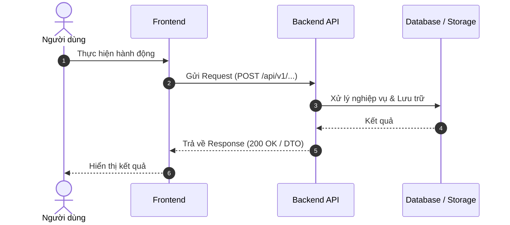

# Feature Specification: [Tên tính năng]

> **Trạng thái:** [Draft / In Review / Approved]  
> **Người phụ trách:** [Tên người phụ trách / AI Agent]  
> **Ánh xạ UI Figma:** [Link / Tên màn hình trong figma nếu có]  
> **Tài liệu liên quan:** [Link PRD / API Contract]

---

## 1. Mục tiêu & Phạm vi (Goal & Scope)

### Mục tiêu chính
- [Mô tả ngắn gọn giá trị tính năng mang lại cho người dùng và hệ thống]

### Phạm vi triển khai (In-scope)
- [ ] [Chức năng 1]
- [ ] [Chức năng 2]

### Ngoài phạm vi (Out-of-scope / Explicit Non-Goals)
> [!IMPORTANT]
> Những phần dưới đây **KHÔNG** làm trong phạm vi tính năng này để tránh phình phạm vi (scope creep):
- [Không làm điều gì trong lần này]

---

## 2. Luồng nghiệp vụ (Business Flow)



### Chi tiết các bước:
1. **Bước 1:** ...
2. **Bước 2:** ...

---

## 3. Giao ước Dữ liệu & API (Data & API Contract)

### 3.1. API Endpoints
- **Method & Route:** `POST /api/v1/[resource]`
- **Quyền hạn (Auth):** `Bearer Token` / `Admin / User`

#### Request Payload
```json
{
  "fieldA": "string",
  "fieldB": 123
}
```

#### Response Payload (200 OK)
```json
{
  "id": "uuid",
  "fieldA": "string",
  "createdAt": "2026-11-01T00:00:00Z"
}
```

#### Xử lý lỗi (Errors & Status Codes)
- `400 Bad Request`: Dữ liệu không hợp lệ (ValidationProblemDetails).
- `401 / 403`: Chưa đăng nhập hoặc không đủ quyền.
- `404 Not Found`: Không tìm thấy thực thể liên quan.

---

## 4. Ràng buộc & Ngoại lệ (Edge Cases & Constraints)

### Ràng buộc bất biến (Invariants & Business Rules)
- [Quy tắc 1: Ví dụ số lần thi không vượt quá giới hạn]
- [Quy tắc 2: Không được phép sửa bài sau khi đã submit]

### Các trường hợp biên (Edge Cases)
- **Trường hợp A:** Mạng ngắt quãng khi đang upload file -> Xử lý ...
- **Trường hợp B:** File âm thanh vượt quá 10MB -> Trả về lỗi 400 kèm message rõ ràng.

---

## 5. Tiêu chí nghiệm thu (Acceptance Criteria - Gherkin)

```gherkin
Scenario: Người dùng gửi yêu cầu thành công
  Given người dùng đã đăng nhập với tài khoản hợp lệ
  When gửi dữ liệu hợp lệ đến endpoint
  Then hệ thống lưu dữ liệu vào database
  And trả về mã HTTP 200 kèm DTO dữ liệu

Scenario: Gửi dữ liệu không hợp lệ
  Given người dùng gửi trường "fieldA" bị rỗng
  When gọi API
  Then hệ thống trả về mã HTTP 400 kèm chi tiết lỗi validation
```
