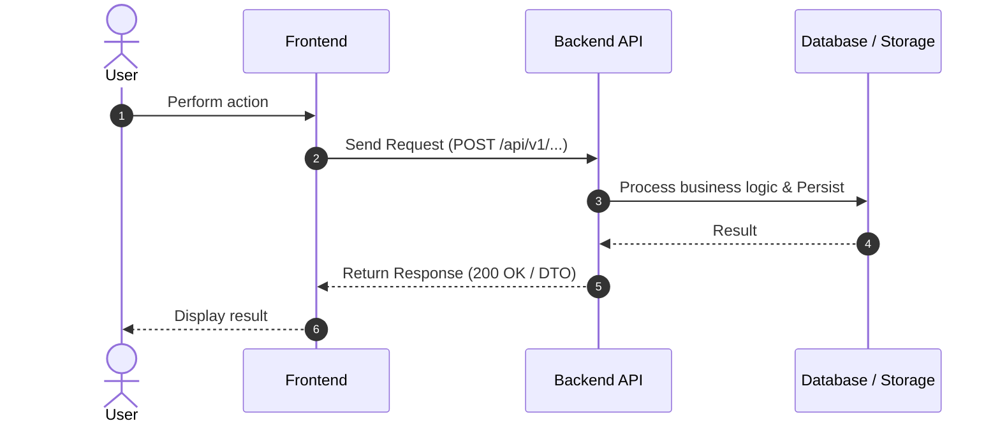

# Feature Specification: [Feature Name]

> **Status:** [Draft / In Review / Approved]  
> **Owner:** [Owner Name / AI Agent]  
> **Figma UI Mapping:** [Link / Figma screen name if applicable]  
> **Related Docs:** [Link PRD / API Contract]

---

## 1. Goal & Scope

### Primary Goal
- [Brief description of the value this feature brings to users and the system]

### In-Scope
- [ ] [Capability 1]
- [ ] [Capability 2]

### Out-of-Scope (Explicit Non-Goals)
> [!IMPORTANT]
> The following items are **NOT** included in this feature's scope to prevent scope creep:
- [What will not be done in this iteration]

---

## 2. Business Flow



### Step Details:
1. **Step 1:** ...
2. **Step 2:** ...

---

## 3. Data & API Contract

### 3.1. API Endpoints
- **Method & Route:** `POST /api/v1/[resource]`
- **Authorization:** `Bearer Token` / `Admin / User`

#### Request Payload
```json
{
  "fieldA": "string",
  "fieldB": 123
}
```

#### Response Payload (200 OK)
```json
{
  "id": "uuid",
  "fieldA": "string",
  "createdAt": "2026-11-01T00:00:00Z"
}
```

#### Error Handling (Errors & Status Codes)
- `400 Bad Request`: Invalid input data (ValidationProblemDetails).
- `401 / 403`: Unauthenticated or insufficient permissions.
- `404 Not Found`: Related entity not found.

---

## 4. Edge Cases & Constraints

### Invariants & Business Rules
- [Rule 1: e.g., number of attempts does not exceed limit]
- [Rule 2: Editing is prohibited after submission]

### Edge Cases
- **Case A:** Network interruption during file upload -> Handle ...
- **Case B:** Audio file exceeds 10MB -> Return 400 error with clear message.

---

## 5. Acceptance Criteria (Gherkin)

```gherkin
Scenario: User submits a valid request
  Given the user is signed in with a valid account
  When valid data is sent to the endpoint
  Then the system persists the data to the database
  And returns HTTP 200 with the data DTO

Scenario: Invalid data is submitted
  Given the user sends an empty "fieldA" field
  When calling the API
  Then the system returns HTTP 400 with validation error details
```
