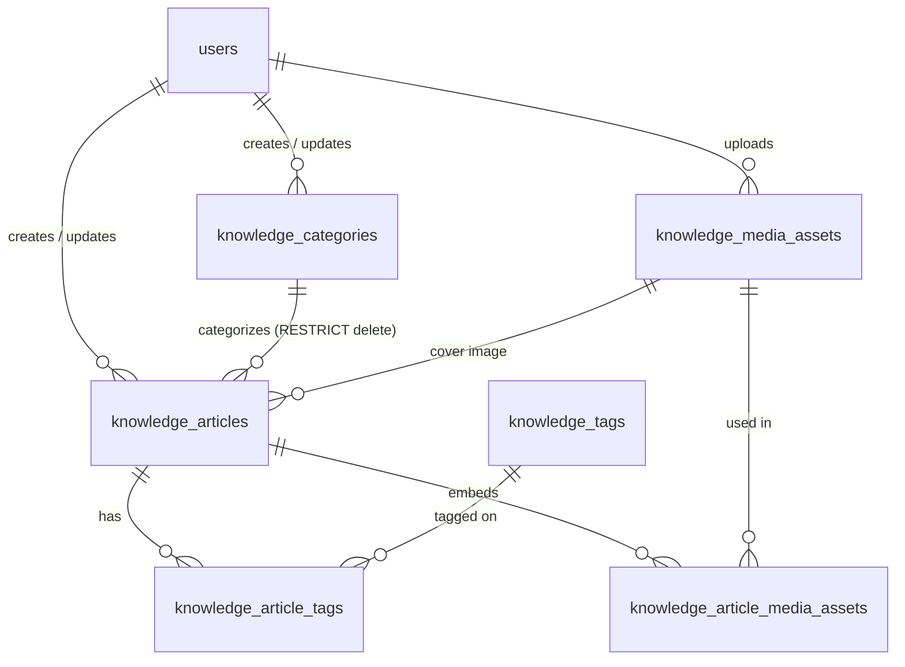

# Design Proposal: Knowledge Base & Sample Materials

## 1. Summary of Agreed Scope & Business Rules

1. **Content nature:** Knowledge articles in article/blog format authored by Admin focusing on the TOEIC exam (guides, test-taking tips, reference materials & sample responses).
2. **Taxonomy:**
   - Categorized by **Skill (`Skill`)**: `General`, `Listening`, `Reading`, `Speaking`, `Writing` *(not split by Part)*.
   - Dynamic **Categories (`knowledge_categories`)** that Admin can add/edit/delete.
     Block deletion (`409 Conflict`) if the category currently has articles belonging to it.
   - Supports **Tags** (normalized keyword tags) for filtering and search.
   - Does not support PDF/DOCX file attachments.
3. **Content Format & Authoring:**
   - Stored as **structured JSON** (Rich Text JSON: paragraphs, bold, italic, links, lists, H2/H3/H4 heading levels, embedded images).
   - Automatically extracts **Table of Contents (`toc_json`)** from heading levels for quick scrolling and calculates **estimated reading time**.
   - Provides **Admin Preview Mode** displaying the finished article UI identical to the Learner view.
4. **Media:** Only supports **images** (cover image + inline content images), stored on MinIO/S3, verified by file signature (magic bytes), max 5 MiB (PNG/JPEG/WebP).
   Video is not supported.
5. **Lifecycle, URL & Read Access:**
   - Article statuses: `Draft` $\leftrightarrow$ `Published` $\leftrightarrow$ `Archived`.
   - Allows Admin to **edit directly** or **unpublish (`Unpublish`)** published articles.
   - Uses a unique **friendly slug** (e.g., `/knowledge/toeic-reading-tips`).
   - Open publicly (`AllowAnonymous`) for unauthenticated **Guests** to read `Published` articles.

---

## 2. Database Design Proposal (PostgreSQL - 6 new tables)

The design follows `snake_case` naming conventions, `uuid` primary keys, `*_utc` timestamps, optimistic concurrency (`version`), and separate image storage consistent with the existing Speaking/Writing modules in `TOEICMaster-BE`.

### 2.1. Entity Relationship Diagram (ERD)

### 2.2. Table Details & Key Constraints

#### 1. `knowledge_categories` (Article Categories)
* **Purpose:** Manages Admin-defined article categories (e.g., *Test Tips*, *Exam Strategies*, *Sample Responses*, *Core Grammar*).
* **Key columns:**
  - `id` (`uuid`, PK)
  - `name` (`varchar(100)`, NOT NULL)
  - `slug` (`varchar(120)`, NOT NULL, **UNIQUE** on `lower(slug)`)
  - `description` (`varchar(500)`, NULL)
  - `display_order` (`int`, NOT NULL, default `0`)
  - `created_by_user_id`, `updated_by_user_id` (`uuid`, FK $\rightarrow$ `users.id`, `RESTRICT`)
  - `created_at_utc`, `updated_at_utc` (`timestamptz`, NOT NULL)
  - `version` (`int`, Concurrency Token)

#### 2. `knowledge_articles` (Knowledge Articles)
* **Purpose:** Stores all metadata, Rich Text JSON content, table of contents, and publish status for each article.
* **Key columns:**
  - `id` (`uuid`, PK)
  - `title` (`varchar(200)`, NOT NULL)
  - `slug` (`varchar(220)`, NOT NULL, **UNIQUE** on `lower(slug)`)
  - `summary` (`varchar(500)`, NOT NULL - short description displayed in lists & preview cards)
  - `skill` (`smallint`, NOT NULL - Enum: `General = 0`, `Listening = 1`, `Reading = 2`, `Speaking = 3`, `Writing = 4`)
  - `category_id` (`uuid`, NOT NULL, FK $\rightarrow$ `knowledge_categories.id`, **`ON DELETE RESTRICT`** to block deleting a category that still has articles)
  - `cover_image_asset_id` (`uuid`, NULL, FK $\rightarrow$ `knowledge_media_assets.id`, `RESTRICT`)
  - `cover_image_alt` (`varchar(300)`, NULL)
  - `content_json` (`jsonb`, NOT NULL - structured Rich Text JSON content)
  - `toc_json` (`jsonb`, NOT NULL - table of contents array `[{ id, level, text }]` auto-extracted from heading levels)
  - `estimated_read_minutes` (`int`, NOT NULL - estimated reading time computed from content)
  - `status` (`smallint`, NOT NULL - Enum: `Draft = 1`, `Published = 2`, `Archived = 3`)
  - `published_at_utc` (`timestamptz`, NULL)
  - `created_by_user_id`, `updated_by_user_id` (`uuid`, FK $\rightarrow$ `users.id`, `RESTRICT`)
  - `created_at_utc`, `updated_at_utc` (`timestamptz`, NOT NULL)
  - `version` (`int`, Concurrency Token)
* **Key indexes:**
  - Unique index on `lower(slug)`
  - Composite index `(status, skill, category_id, published_at_utc DESC)` for fast filtering & pagination for both Admin and Public.

#### 3. `knowledge_tags` (Keyword Tags)
* **Purpose:** Normalizes the tag list for reuse, Admin autocomplete suggestions, and article filtering.
* **Key columns:**
  - `id` (`uuid`, PK)
  - `name` (`varchar(50)`, NOT NULL)
  - `slug` (`varchar(64)`, NOT NULL, **UNIQUE** on `lower(slug)`)
  - `created_at_utc` (`timestamptz`, NOT NULL)

#### 4. `knowledge_article_tags` (Article - Tag Join Table)
* **Purpose:** Many-to-many (M-N) relationship between articles and tags.
* **Key columns:**
  - `article_id` (`uuid`, FK $\rightarrow$ `knowledge_articles.id`, `CASCADE`)
  - `tag_id` (`uuid`, FK $\rightarrow$ `knowledge_tags.id`, `CASCADE`)
  - Composite PK `(article_id, tag_id)` + Index on `tag_id`.

#### 5. `knowledge_media_assets` (Image Metadata Store)
* **Purpose:** Manages cover images and inline article images stored in a MinIO private bucket.
* **Key columns:**
  - `id` (`uuid`, PK)
  - `object_key` (`varchar(256)`, NOT NULL, **UNIQUE**)
  - `original_file_name` (`varchar(255)`, NOT NULL)
  - `content_type` (`varchar(100)`, NOT NULL - accepts only PNG/JPEG/WebP, verified via magic bytes)
  - `byte_length` (`bigint`, NOT NULL, max 5 MiB)
  - `sha256` (`varchar(64)`, NOT NULL)
  - `uploaded_by_user_id` (`uuid`, FK $\rightarrow$ `users.id`, `RESTRICT`)
  - `created_at_utc` (`timestamptz`, NOT NULL)

#### 6. `knowledge_article_media_assets` (Article - Image Join Table)
* **Purpose:** Stores the list of `assetId` values referenced by an article (from the cover image and image nodes in `content_json`).
  Helps the public endpoint `GET /api/v1/knowledge/media/{assetId}` quickly verify via SQL that the image belongs to a `Published` article, preventing `Draft` article images from leaking to Guests.
* **Key columns:**
  - `article_id` (`uuid`, FK $\rightarrow$ `knowledge_articles.id`, `CASCADE`)
  - `media_asset_id` (`uuid`, FK $\rightarrow$ `knowledge_media_assets.id`, `RESTRICT`)
  - Composite PK `(article_id, media_asset_id)` + Index on `media_asset_id`.

---

## 3. Proposed Core APIs

### 3.1. Admin APIs (`/api/v1/admin/knowledge/...`)
*Requires JWT authentication + `KnowledgeAdministration` policy (`Admin` role).*

#### A. Category Management (`categories`)
| Method & Endpoint | Purpose |
| :--- | :--- |
| `GET /api/v1/admin/knowledge/categories` | List categories with the article count per category. |
| `POST /api/v1/admin/knowledge/categories` | Create a new category. |
| `PUT /api/v1/admin/knowledge/categories/{id}` | Update a category's name, slug, description, and display order. |
| `DELETE /api/v1/admin/knowledge/categories/{id}` | Delete a category (blocks deletion and returns `409 Conflict` if articles belong to this category). |

#### B. Tag (`tags`) & Media (`media`) Management
| Method & Endpoint | Purpose |
| :--- | :--- |
| `GET /api/v1/admin/knowledge/tags` | List/search existing tags for autocomplete suggestions while Admin is authoring. |
| `POST /api/v1/admin/knowledge/media/images` | Upload an image (cover image or inline article image) to MinIO, verify magic bytes, and return `assetId`. |
| `GET /api/v1/admin/knowledge/media/{assetId}` | Fetch an image for the editor and **Admin Preview Mode** (also allows viewing images of `Draft` articles). |

#### C. Article Management (`articles`)
| Method & Endpoint | Purpose |
| :--- | :--- |
| `GET /api/v1/admin/knowledge/articles` | List articles with **pagination** and **filtering** (keyword `q` searches only on **title `title`**, skill, category, tag, status, sorting). |
| `GET /api/v1/admin/knowledge/articles/{id}` | Get full article details (`content_json`, `toc_json`, tags, images) for editing or enabling **Admin Preview Mode**. |
| `POST /api/v1/admin/knowledge/articles` | Create a new article in `Draft` status (auto-generates/validates `slug`, auto-extracts table of contents and reading time). |
| `PUT /api/v1/admin/knowledge/articles/{id}` | Update an article (supports editing both `Draft` and `Published` articles, auto-syncs table of contents, tags, and image links). |
| `POST /api/v1/admin/knowledge/articles/{id}/publish` | Publish an article (`Draft`/`Archived` $\rightarrow$ `Published`). |
| `POST /api/v1/admin/knowledge/articles/{id}/unpublish` | Unpublish an article back to draft (`Published` $\rightarrow$ `Draft`). |
| `POST /api/v1/admin/knowledge/articles/{id}/archive` | Archive/hide an article (`Archived`). |
| `DELETE /api/v1/admin/knowledge/articles/{id}` | Delete an article (applies to `Draft` or `Archived` articles; `Published` articles must be unpublished first before deletion). |

---

### 3.2. Public / Learner APIs (`/api/v1/knowledge/...`)
*Publicly accessible (`AllowAnonymous`) for unauthenticated Guests to read published content.*

| Method & Endpoint | Purpose |
| :--- | :--- |
| `GET /api/v1/knowledge/categories` | List public categories (with `Published` article counts) to build Learner filters. |
| `GET /api/v1/knowledge/tags` | List tags currently used by at least 1 `Published` article. |
| `GET /api/v1/knowledge/articles` | List **published** articles with **pagination** and **filtering** (keyword `q` searches only on **title `title`**, skill, category, tag, sorting). |
| `GET /api/v1/knowledge/articles/{slug}` | Read published article details by **friendly slug** (includes `content_json`, `toc_json` for quick-scroll table of contents, and related article suggestions). |
| `GET /api/v1/knowledge/media/{assetId}` | Serve public images for `Published` articles (returns `404` if the image only belongs to a `Draft` article). |

---

## 4. Finalized Frontend Choice

- **Rich Text Editor:** Uses **Tiptap** (`@tiptap/react`, `@tiptap/pm`, `@tiptap/starter-kit`, `@tiptap/extension-image`, `@tiptap/extension-link`, `@tiptap/extension-placeholder`) - supports React 19 and exports structured JSON directly.
