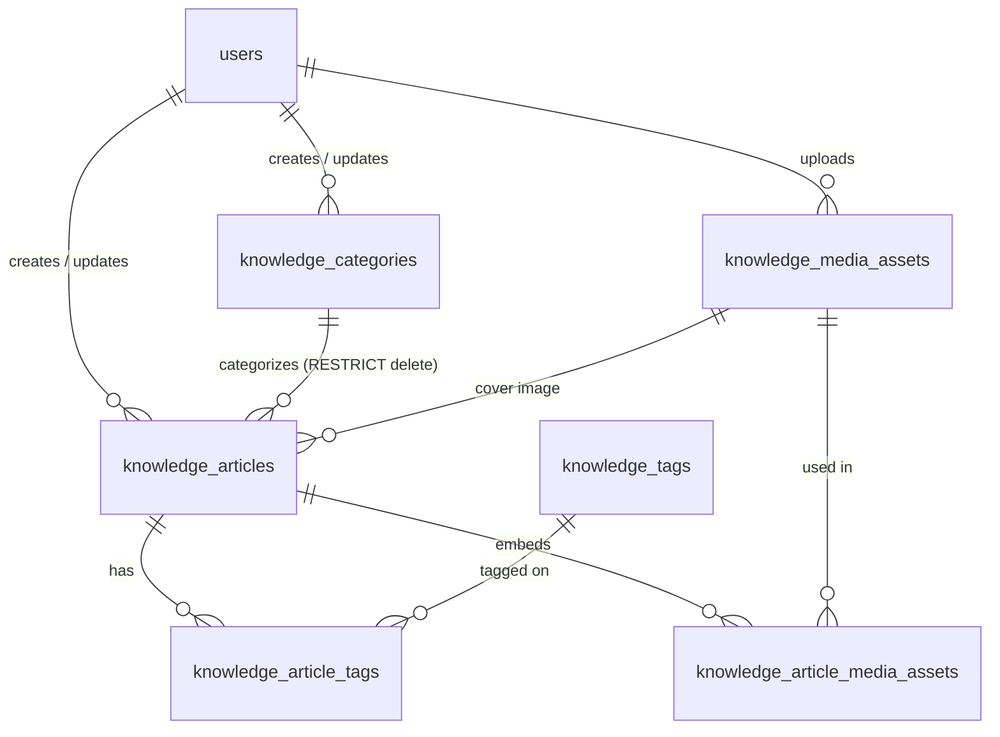

# Đề xuất Thiết kế: Khu vực Kiến thức & Tài liệu mẫu (Knowledge Base)

## 1. Tóm tắt Phạm vi & Nguyên tắc Nghiệp vụ đã chốt

1. **Bản chất nội dung:** Bài viết Kiến thức dạng bài báo/blog do Admin biên soạn xoay quanh kỳ thi TOEIC (hướng dẫn, mẹo làm bài, tài liệu & bài làm mẫu).
2. **Phân loại (Taxonomy):**
   - Phân loại theo **Kỹ năng (`Skill`)**: `General`, `Listening`, `Reading`, `Speaking`, `Writing` *(không chia theo Part)*.
   - Có **Danh mục động (`knowledge_categories`)** cho Admin tự thêm/sửa/xóa. Chặn xóa (`409 Conflict`) nếu danh mục đang có bài viết thuộc về nó.
   - Hỗ trợ gắn **Tags** (thẻ từ khóa chuẩn hóa) để lọc và tìm kiếm.
   - Không hỗ trợ đính kèm file PDF/DOCX.
3. **Định dạng nội dung & Soạn thảo:**
   - Lưu dưới dạng **JSON có cấu trúc** (Rich Text JSON: đoạn văn, in đậm, in nghiêng, gắn link, danh sách, các tầng tiêu đề H2/H3/H4, chèn hình ảnh).
   - Tự động trích xuất **Bảng Mục lục (`toc_json`)** từ các tầng tiêu đề để cuộn nhanh và tính **thời gian đọc ước tính**.
   - Cung cấp **Admin Preview Mode** hiển thị giao diện bài viết hoàn thiện giống góc nhìn Học viên.
4. **Media:** Chỉ hỗ trợ **hình ảnh** (ảnh bìa + ảnh chèn trong nội dung), lưu trên MinIO/S3, kiểm tra chữ ký file (magic bytes), tối đa 5 MiB (PNG/JPEG/WebP). Không hỗ trợ video.
5. **Vòng đời, URL & Quyền xem:**
   - Trạng thái bài viết: `Draft` $\leftrightarrow$ `Published` $\leftrightarrow$ `Archived`.
   - Cho phép Admin **chỉnh sửa trực tiếp** hoặc **gỡ (`Unpublish`)** bài viết đã xuất bản.
   - Sử dụng **slug thân thiện** duy nhất (VD: `/knowledge/meo-lam-reading-toeic`).
   - Mở công khai (`AllowAnonymous`) cho **Khách vãng lai (Guest)** chưa đăng nhập đọc các bài viết đã `Published`.

---

## 2. Đề xuất Thiết kế Database (PostgreSQL — 6 bảng mới)

Thiết kế tuân thủ chuẩn đặt tên `snake_case`, khóa chính `uuid`, thời gian `*_utc`, optimistic concurrency (`version`) và lưu ảnh riêng biệt giống các phân hệ Speaking/Writing hiện tại của `TOEICMaster-BE`.

### 2.1. Sơ đồ quan hệ thực thể (ERD)

### 2.2. Chi tiết các bảng & ràng buộc chính

#### 1. `knowledge_categories` (Danh mục bài viết)
* **Mục đích:** Quản lý danh mục bài viết do Admin tự định nghĩa (VD: *Mẹo làm bài*, *Chiến lược thi*, *Bài làm mẫu*, *Ngữ pháp trọng tâm*).
* **Các cột chính:**
  - `id` (`uuid`, PK)
  - `name` (`varchar(100)`, NOT NULL)
  - `slug` (`varchar(120)`, NOT NULL, **UNIQUE** trên `lower(slug)`)
  - `description` (`varchar(500)`, NULL)
  - `display_order` (`int`, NOT NULL, default `0`)
  - `created_by_user_id`, `updated_by_user_id` (`uuid`, FK $\rightarrow$ `users.id`, `RESTRICT`)
  - `created_at_utc`, `updated_at_utc` (`timestamptz`, NOT NULL)
  - `version` (`int`, Concurrency Token)

#### 2. `knowledge_articles` (Bài viết Kiến thức)
* **Mục đích:** Lưu toàn bộ metadata, nội dung Rich Text JSON, mục lục và trạng thái xuất bản của từng bài viết.
* **Các cột chính:**
  - `id` (`uuid`, PK)
  - `title` (`varchar(200)`, NOT NULL)
  - `slug` (`varchar(220)`, NOT NULL, **UNIQUE** trên `lower(slug)`)
  - `summary` (`varchar(500)`, NOT NULL — đoạn mô tả ngắn hiển thị ở danh sách & thẻ preview)
  - `skill` (`smallint`, NOT NULL — Enum: `General = 0`, `Listening = 1`, `Reading = 2`, `Speaking = 3`, `Writing = 4`)
  - `category_id` (`uuid`, NOT NULL, FK $\rightarrow$ `knowledge_categories.id`, **`ON DELETE RESTRICT`** để chặn xóa danh mục đang có bài viết)
  - `cover_image_asset_id` (`uuid`, NULL, FK $\rightarrow$ `knowledge_media_assets.id`, `RESTRICT`)
  - `cover_image_alt` (`varchar(300)`, NULL)
  - `content_json` (`jsonb`, NOT NULL — nội dung Rich Text JSON có cấu trúc)
  - `toc_json` (`jsonb`, NOT NULL — mảng mục lục `[{ id, level, text }]` tự trích xuất từ các tầng tiêu đề)
  - `estimated_read_minutes` (`int`, NOT NULL — thời gian đọc ước tính tính từ nội dung)
  - `status` (`smallint`, NOT NULL — Enum: `Draft = 1`, `Published = 2`, `Archived = 3`)
  - `published_at_utc` (`timestamptz`, NULL)
  - `created_by_user_id`, `updated_by_user_id` (`uuid`, FK $\rightarrow$ `users.id`, `RESTRICT`)
  - `created_at_utc`, `updated_at_utc` (`timestamptz`, NOT NULL)
  - `version` (`int`, Concurrency Token)
* **Indexes trọng tâm:**
  - Unique index trên `lower(slug)`
  - Composite index `(status, skill, category_id, published_at_utc DESC)` phục vụ lọc & phân trang nhanh cho cả Admin và Public.

#### 3. `knowledge_tags` (Thẻ từ khóa)
* **Mục đích:** Chuẩn hóa danh sách tag để tái sử dụng, gợi ý autocomplete cho Admin và lọc bài viết.
* **Các cột chính:**
  - `id` (`uuid`, PK)
  - `name` (`varchar(50)`, NOT NULL)
  - `slug` (`varchar(64)`, NOT NULL, **UNIQUE** trên `lower(slug)`)
  - `created_at_utc` (`timestamptz`, NOT NULL)

#### 4. `knowledge_article_tags` (Liên kết Bài viết – Tag)
* **Mục đích:** Quan hệ N–N giữa bài viết và tag.
* **Các cột chính:**
  - `article_id` (`uuid`, FK $\rightarrow$ `knowledge_articles.id`, `CASCADE`)
  - `tag_id` (`uuid`, FK $\rightarrow$ `knowledge_tags.id`, `CASCADE`)
  - Composite PK `(article_id, tag_id)` + Index trên `tag_id`.

#### 5. `knowledge_media_assets` (Kho metadata hình ảnh)
* **Mục đích:** Quản lý ảnh bìa và ảnh chèn trong bài viết lưu trên MinIO private bucket.
* **Các cột chính:**
  - `id` (`uuid`, PK)
  - `object_key` (`varchar(256)`, NOT NULL, **UNIQUE**)
  - `original_file_name` (`varchar(255)`, NOT NULL)
  - `content_type` (`varchar(100)`, NOT NULL — chỉ chấp nhận PNG/JPEG/WebP, xác thực magic bytes)
  - `byte_length` (`bigint`, NOT NULL, tối đa 5 MiB)
  - `sha256` (`varchar(64)`, NOT NULL)
  - `uploaded_by_user_id` (`uuid`, FK $\rightarrow$ `users.id`, `RESTRICT`)
  - `created_at_utc` (`timestamptz`, NOT NULL)

#### 6. `knowledge_article_media_assets` (Liên kết Bài viết – Hình ảnh)
* **Mục đích:** Lưu danh sách `assetId` mà bài viết đang tham chiếu (từ ảnh bìa và các node ảnh trong `content_json`). Giúp endpoint công khai `GET /api/v1/knowledge/media/{assetId}` kiểm tra nhanh bằng SQL rằng ảnh thuộc bài đã `Published`, tránh lộ ảnh của bài `Draft` ra cho Guest.
* **Các cột chính:**
  - `article_id` (`uuid`, FK $\rightarrow$ `knowledge_articles.id`, `CASCADE`)
  - `media_asset_id` (`uuid`, FK $\rightarrow$ `knowledge_media_assets.id`, `RESTRICT`)
  - Composite PK `(article_id, media_asset_id)` + Index trên `media_asset_id`.

---

## 3. Đề xuất Danh sách APIs chính

### 3.1. Nhóm Admin APIs (`/api/v1/admin/knowledge/...`)
*Yêu cầu xác thực JWT + Policy `KnowledgeAdministration` (role `Admin`).*

#### A. Quản lý Danh mục (`categories`)
| Method & Endpoint | Mục đích |
| :--- | :--- |
| `GET /api/v1/admin/knowledge/categories` | Lấy danh sách danh mục kèm số lượng bài viết thuộc từng danh mục. |
| `POST /api/v1/admin/knowledge/categories` | Tạo danh mục mới. |
| `PUT /api/v1/admin/knowledge/categories/{id}` | Cập nhật tên, slug, mô tả và thứ tự hiển thị của danh mục. |
| `DELETE /api/v1/admin/knowledge/categories/{id}` | Xóa danh mục (chặn xóa và trả `409 Conflict` nếu đang có bài viết thuộc danh mục này). |

#### B. Quản lý Thẻ (`tags`) & Hình ảnh (`media`)
| Method & Endpoint | Mục đích |
| :--- | :--- |
| `GET /api/v1/admin/knowledge/tags` | Lấy/tìm kiếm danh sách tag có sẵn để gợi ý autocomplete khi Admin soạn bài. |
| `POST /api/v1/admin/knowledge/media/images` | Upload hình ảnh (ảnh bìa hoặc ảnh chèn trong bài) lên MinIO, xác thực magic bytes và trả về `assetId`. |
| `GET /api/v1/admin/knowledge/media/{assetId}` | Tải hình ảnh cho trình soạn thảo và **Admin Preview Mode** (xem được cả ảnh của bài `Draft`). |

#### C. Quản lý Bài viết (`articles`)
| Method & Endpoint | Mục đích |
| :--- | :--- |
| `GET /api/v1/admin/knowledge/articles` | Lấy danh sách bài viết có **phân trang** và **lọc** (từ khóa `q` chỉ tìm trên **tiêu đề `title`**, kỹ năng, danh mục, tag, trạng thái, sắp xếp). |
| `GET /api/v1/admin/knowledge/articles/{id}` | Lấy đầy đủ chi tiết bài viết (`content_json`, `toc_json`, tags, ảnh) để chỉnh sửa hoặc bật **Admin Preview Mode**. |
| `POST /api/v1/admin/knowledge/articles` | Tạo bài viết mới ở trạng thái `Draft` (tự sinh/kiểm tra `slug`, tự trích xuất mục lục và thời gian đọc). |
| `PUT /api/v1/admin/knowledge/articles/{id}` | Cập nhật bài viết (hỗ trợ sửa cả bài `Draft` lẫn bài đang `Published`, tự đồng bộ mục lục, tags và liên kết ảnh). |
| `POST /api/v1/admin/knowledge/articles/{id}/publish` | Xuất bản bài viết (`Draft`/`Archived` $\rightarrow$ `Published`). |
| `POST /api/v1/admin/knowledge/articles/{id}/unpublish` | Gỡ bài viết đã xuất bản về lại bản nháp (`Published` $\rightarrow$ `Draft`). |
| `POST /api/v1/admin/knowledge/articles/{id}/archive` | Lưu trữ/ẩn bài viết (`Archived`). |
| `DELETE /api/v1/admin/knowledge/articles/{id}` | Xóa bài viết (áp dụng cho bài `Draft` hoặc `Archived`; bài `Published` cần gỡ trước khi xóa). |

---

### 3.2. Nhóm Public / Học viên APIs (`/api/v1/knowledge/...`)
*Mở công khai (`AllowAnonymous`) cho cả Khách vãng lai (Guest) chưa đăng nhập đọc nội dung đã xuất bản.*

| Method & Endpoint | Mục đích |
| :--- | :--- |
| `GET /api/v1/knowledge/categories` | Lấy danh sách danh mục công khai (kèm số bài đã `Published`) để dựng bộ lọc phía Học viên. |
| `GET /api/v1/knowledge/tags` | Lấy danh sách tag đang được dùng bởi ít nhất 1 bài đã `Published`. |
| `GET /api/v1/knowledge/articles` | Lấy danh sách bài viết **đã xuất bản** có **phân trang** và **lọc** (từ khóa `q` chỉ tìm trên **tiêu đề `title`**, kỹ năng, danh mục, tag, sắp xếp). |
| `GET /api/v1/knowledge/articles/{slug}` | Đọc chi tiết bài viết đã xuất bản theo **slug thân thiện** (kèm `content_json`, `toc_json` cho mục lục cuộn nhanh và gợi ý bài viết liên quan). |
| `GET /api/v1/knowledge/media/{assetId}` | Phục vụ hình ảnh công khai cho các bài viết đã `Published` (trả `404` nếu ảnh chỉ nằm trong bài `Draft`). |

---

## 4. Lựa chọn đã chốt cho Frontend

- **Rich Text Editor:** Sử dụng bộ **Tiptap** (`@tiptap/react`, `@tiptap/pm`, `@tiptap/starter-kit`, `@tiptap/extension-image`, `@tiptap/extension-link`, `@tiptap/extension-placeholder`) — hỗ trợ React 19 và xuất trực tiếp JSON có cấu trúc.
