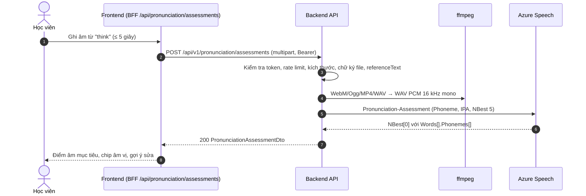

# Feature Specification: Luyện phát âm IPA (Learner)

> **Trạng thái:** In Review
> **Người phụ trách:** Tân Mai Phú
> **Jira:** CNPMCS-60 (epic CNPMCS-55)
> **Tài liệu liên quan:** Spec frontend `TOEICMaster-FE/docs/ipaPage.md` (§9.1 là nguồn của contract này)

---

## 1. Mục tiêu & Phạm vi

### Mục tiêu chính

Học viên đọc một từ ví dụ của một âm IPA (ví dụ `think` cho /θ/). Backend chấm bản thu ở mức **âm vị**, trả về
điểm từng âm và các âm hệ thống nghe ra, để frontend tính điểm riêng cho âm đang luyện.

### Phạm vi

- [x] `POST /api/v1/pronunciation/assessments`: nhận một bản thu ngắn, trả kết quả chấm.
- [x] Chấm bằng Azure Pronunciation Assessment: có `ReferenceText`, `Granularity=Phoneme`, `PhonemeAlphabet=IPA`, `NBestPhonemeCount=5`.
- [x] Yêu cầu đăng nhập, giới hạn 30 lần/phút cho mỗi người dùng đã xác thực.

### Ngoài phạm vi

> [!IMPORTANT]
>
> - Không lưu bản thu, không lưu điểm, không có bảng dữ liệu hay migration. Bản thu chỉ xử lý trong bộ nhớ.
> - Không có trang Admin. Dữ liệu 44 âm là tĩnh ở frontend.
> - Không gộp vào Speaking: không thêm route, handler hay lịch sử nào vào Speaking.

## 2. Tách biệt với các tính năng khác

Toàn bộ code nằm trong file mới:

| Lớp            | File                                                                                       |
| -------------- | ------------------------------------------------------------------------------------------ |
| Application    | `src/TOEICMaster.Application/Pronunciation/*`                                              |
| Infrastructure | `src/TOEICMaster.Infrastructure/Pronunciation/*` (assessor, ffmpeg converter, options, DI) |
| Api            | `Controllers/PronunciationController.cs`, `Configuration/PronunciationConfiguration.cs`    |
| Tests          | `tests/.../{Application,Infrastructure,Api}/Pronunciation/*`, `TestDoubles/PronunciationTestDoubles.cs` |

- Không dùng lại code Speaking. Converter ffmpeg và assessor là bản riêng (`IPronunciationAudioConverter`, `AzurePronunciationAssessor`).
- Cấu hình **chỉ đọc** chung mục `AzureSpeech` (`Enabled`, `Key`, `Region`, `Endpoint`, `RequestTimeoutSeconds`, `FfmpegPath`), để một Azure Speech resource dùng cho cả hai tính năng. Không thêm biến môi trường mới.
- Lỗi được chuyển thành ProblemDetails ngay trong controller, không thêm exception handler toàn cục.
- Hai chỗ chạm vào file có sẵn, mỗi chỗ đúng một dòng:
  1. `src/TOEICMaster.Api/Program.cs`: `builder.Services.AddPronunciation(builder.Configuration);`
  2. `tests/.../Application/Common/MediatorPipelineTests.cs`: đăng ký `SilentPronunciationAssessor`. Test này kiểm tra mọi handler MediatR đều resolve được, nên tính năng nào có handler mới cũng phải thêm một dòng ở đây.

## 3. Luồng nghiệp vụ



## 4. API

### `POST /api/v1/pronunciation/assessments`

- **Auth:** Bearer token (người dùng đã đăng nhập). Chưa đăng nhập → `401`.
- **Content-Type:** `multipart/form-data`.
- **Rate limit:** 30 request/phút cho mỗi người dùng đã xác thực hoặc theo địa chỉ IP kết nối khi thiếu token hay token không hợp lệ.
  Vượt giới hạn trả `429` kèm `Retry-After`.

| Field           | Bắt buộc | Ràng buộc                                                                                     |
| --------------- | -------- | --------------------------------------------------------------------------------------------- |
| `file`          | Có       | WebM, Ogg, MP4 hoặc WAV, nhận diện theo chữ ký file; tối đa 1 MiB; sau khi giải mã tối đa 10 giây |
| `referenceText` | Có       | 1–40 ký tự sau khi trim, chỉ chữ cái tiếng Anh, khoảng trắng, `'` và `-`                       |
| `locale`        | Không    | `en-US` (mặc định) hoặc `en-GB`                                                               |

#### Response `200 OK`

```json
{
  "recognitionStatus": "Recognized",
  "referenceText": "think",
  "recognizedText": "Think.",
  "accuracyScore": 78.0,
  "pronunciationScore": 80.5,
  "completenessScore": 100.0,
  "words": [
    {
      "word": "think",
      "accuracyScore": 78.0,
      "errorType": "None",
      "phonemes": [
        {
          "phoneme": "θ",
          "accuracyScore": 54.0,
          "candidates": [
            { "phoneme": "s", "score": 71.0 },
            { "phoneme": "θ", "score": 54.0 }
          ]
        },
        { "phoneme": "ɪ", "accuracyScore": 92.0, "candidates": [] }
      ]
    }
  ]
}
```

- Mọi điểm nằm trong khoảng 0–100, làm tròn 1 chữ số thập phân.
- `recognitionStatus` là `Recognized` hoặc `NoSpeech`. Khi `NoSpeech` (im lặng, bản thu < 0,2 giây, Azure trả `NoMatch`/`InitialSilenceTimeout`), mọi điểm bằng 0, `recognizedText` rỗng, `words` là `[]`.

#### Lỗi (ProblemDetails, `application/problem+json`, có `code` và `traceId`)

| Status | `code`                  | Khi nào                                                        |
| ------ | ----------------------- | -------------------------------------------------------------- |
| 400    | `INVALID_AUDIO`         | Thiếu file, sai định dạng, không giải mã được, dài quá 10 giây  |
| 400    | (ValidationProblemDetails) | `referenceText` hoặc `locale` không hợp lệ                  |
| 401    | —                       | Chưa đăng nhập                                                 |
| 413    | `INVALID_AUDIO`         | File vượt 1 MiB                                                |
| 422    | `SPEECH_REJECTED`       | Azure trả 400 cho bản thu                                      |
| 429    | —                       | Vượt rate limit, có `Retry-After`                              |
| 502    | `SPEECH_PROVIDER_ERROR` | Azure lỗi 5xx/429, lỗi mạng, phản hồi không đọc được           |
| 503    | `NOT_CONFIGURED`        | Azure Speech tắt/thiếu key, key sai (401/403), hoặc máy chủ thiếu ffmpeg |
| 504    | `SPEECH_TIMEOUT`        | ffmpeg hoặc Azure quá thời gian                                |

`title` luôn là câu tiếng Việt an toàn để hiển thị, không chứa chi tiết nội bộ.

## 5. Cấu hình & vận hành

- Bật bằng các biến đã có: `AZURE_SPEECH_ENABLED=true`, `AZURE_SPEECH_KEY`, `AZURE_SPEECH_REGION` (docker compose) hoặc `AzureSpeech__*`.
- Cần `ffmpeg` trên máy chạy API. Image trong `docker-compose.override.yml` đã cài sẵn.
- Thiếu cấu hình thì API vẫn khởi động bình thường; endpoint trả `503 NOT_CONFIGURED`.

## 6. Tiêu chí nghiệm thu

```gherkin
Scenario: Chấm phát âm một từ ví dụ
  Given học viên đã đăng nhập và Azure Speech đã cấu hình
  When gửi bản thu WebM đọc "think" với referenceText "think"
  Then trả về 200 với điểm từng âm vị theo ký hiệu IPA và candidates

Scenario: Chưa đăng nhập
  When gửi bản thu mà không có Bearer token
  Then trả về 401 và không gọi Azure

Scenario: Dữ liệu không hợp lệ
  When referenceText chứa chữ số hoặc file không phải audio hỗ trợ
  Then trả về 400 và không gọi Azure

Scenario: Dịch vụ chưa cấu hình
  Given AzureSpeech:Enabled=false
  When gửi bản thu hợp lệ
  Then trả về 503 với code NOT_CONFIGURED
```

Kiểm thử: `AssessPronunciationTests` (validator, nhận diện audio, handler), `AzurePronunciationAssessorTests` (header Azure, parse kết quả, ánh xạ lỗi), `PronunciationApiTests` (401, contract JSON, 400/413/422/502/503/504; cần `TOEICMASTER_TEST_POSTGRES` như các API test khác).
