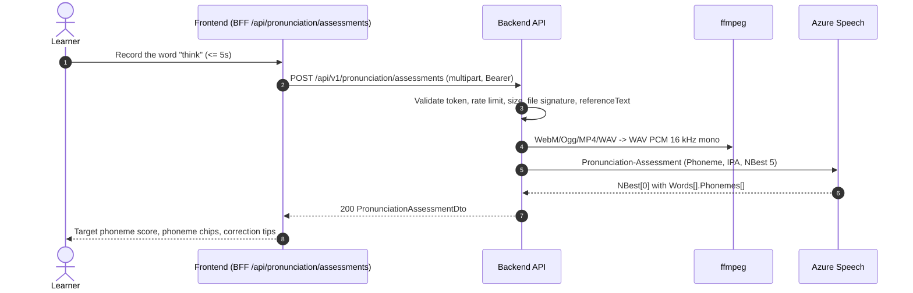

# Feature Specification: IPA Pronunciation Practice (Learner)

> **Status:** In Review
> **Owner:** Tan Mai Phu
> **Jira:** CNPMCS-60 (epic CNPMCS-55)
> **Related Docs:** Frontend spec `TOEICMaster-FE/docs/ipaPage.md` (§9.1 is the source for this contract)

---

## 1. Goals & Scope

### Primary Goal

A learner reads an example word for an IPA phoneme (for example, `think` for /θ/).
The backend grades the recording at the **phoneme** level and returns per-phoneme scores along with recognized candidate phonemes so the frontend can compute the score for the target phoneme being practiced.

### Scope

- [x] `POST /api/v1/pronunciation/assessments`: accepts a short recording and returns assessment results.
- [x] Graded via Azure Pronunciation Assessment with `ReferenceText`, `Granularity=Phoneme`, `PhonemeAlphabet=IPA`, and `NBestPhonemeCount=5`.
- [x] Requires authentication, rate-limited to 30 requests/minute per authenticated user.

### Out of Scope

> [!IMPORTANT]
>
> - Recordings and scores are not persisted; there are no database tables or migrations. Recordings are processed strictly in memory.
> - No Admin page. Data for the 44 phonemes is static on the frontend.
> - Not merged into Speaking: do not add any routes, handlers, or history into Speaking.

## 2. Isolation from Other Features

All code lives in new files:

| Layer          | Files                                                                                      |
| -------------- | ------------------------------------------------------------------------------------------ |
| Application    | `src/TOEICMaster.Application/Pronunciation/*`                                              |
| Infrastructure | `src/TOEICMaster.Infrastructure/Pronunciation/*` (assessor, ffmpeg converter, options, DI) |
| Api            | `Controllers/PronunciationController.cs`, `Configuration/PronunciationConfiguration.cs`    |
| Tests          | `tests/.../{Application,Infrastructure,Api}/Pronunciation/*`, `TestDoubles/PronunciationTestDoubles.cs` |

- Does not reuse Speaking code. The ffmpeg converter and assessor are dedicated implementations (`IPronunciationAudioConverter`, `AzurePronunciationAssessor`).
- Configuration **reads only** from the shared `AzureSpeech` section (`Enabled`, `Key`, `Region`, `Endpoint`, `RequestTimeoutSeconds`, `FfmpegPath`), allowing one Azure Speech resource to serve both features. No new environment variables are introduced.
- Errors are mapped to ProblemDetails directly in the controller without adding a global exception handler.
- Only two existing files are touched, each by a single line:
  1. `src/TOEICMaster.Api/Program.cs`: `builder.Services.AddPronunciation(builder.Configuration);`
  2. `tests/.../Application/Common/MediatorPipelineTests.cs`: registers `SilentPronunciationAssessor`. This test verifies that every MediatR handler resolves cleanly, so any feature adding a new handler must add a line here as well.

## 3. Business Flow



## 4. API

### `POST /api/v1/pronunciation/assessments`

- **Auth:** Bearer token (authenticated user). Unauthenticated -> `401`.
- **Content-Type:** `multipart/form-data`.
- **Rate limit:** 30 requests/minute per authenticated user, or by client connection IP when the token is missing or invalid.
  Exceeding the limit returns `429` with `Retry-After`.

| Field           | Required | Constraints                                                                                     |
| --------------- | -------- | ----------------------------------------------------------------------------------------------- |
| `file`          | Yes      | WebM, Ogg, MP4, or WAV, detected by file signature; max 1 MiB; max 10 seconds after decoding    |
| `referenceText` | Yes      | 1-40 characters after trimming, English letters, spaces, `'`, and `-` only                      |
| `locale`        | No       | `en-US` (default) or `en-GB`                                                                    |

#### Response `200 OK`

```json
{
  "recognitionStatus": "Recognized",
  "referenceText": "think",
  "recognizedText": "Think.",
  "accuracyScore": 78.0,
  "pronunciationScore": 80.5,
  "completenessScore": 100.0,
  "words": [
    {
      "word": "think",
      "accuracyScore": 78.0,
      "errorType": "None",
      "phonemes": [
        {
          "phoneme": "θ",
          "accuracyScore": 54.0,
          "candidates": [
            { "phoneme": "s", "score": 71.0 },
            { "phoneme": "θ", "score": 54.0 }
          ]
        },
        { "phoneme": "ɪ", "accuracyScore": 92.0, "candidates": [] }
      ]
    }
  ]
}
```

- All scores are in the 0-100 range, rounded to 1 decimal place.
- `recognitionStatus` is `Recognized` or `NoSpeech`. When `NoSpeech` (silence, recording < 0.2s, or Azure returns `NoMatch`/`InitialSilenceTimeout`), all scores are 0, `recognizedText` is empty, and `words` is `[]`.

#### Errors (ProblemDetails, `application/problem+json`, with `code` and `traceId`)

| Status | `code`                     | When                                                                      |
| ------ | -------------------------- | ------------------------------------------------------------------------- |
| 400    | `INVALID_AUDIO`            | Missing file, invalid format, undecodable audio, or duration over 10s     |
| 400    | (ValidationProblemDetails) | Invalid `referenceText` or `locale`                                       |
| 401    | -                          | Unauthenticated                                                           |
| 413    | `INVALID_AUDIO`            | File exceeds 1 MiB                                                        |
| 422    | `SPEECH_REJECTED`          | Azure returns 400 for the recording                                       |
| 429    | -                          | Rate limit exceeded, includes `Retry-After`                               |
| 502    | `SPEECH_PROVIDER_ERROR`    | Azure 5xx/429 error, network error, or unreadable response                |
| 503    | `NOT_CONFIGURED`           | Azure Speech disabled/missing key, invalid key (401/403), or missing ffmpeg on host |
| 504    | `SPEECH_TIMEOUT`           | ffmpeg or Azure timed out                                                 |

`title` is always a safe Vietnamese sentence suitable for display, containing no internal details.

## 5. Configuration & Operations

- Enabled via existing variables: `AZURE_SPEECH_ENABLED=true`, `AZURE_SPEECH_KEY`, `AZURE_SPEECH_REGION` (docker compose) or `AzureSpeech__*`.
- Requires `ffmpeg` on the machine running the API. The image in `docker-compose.override.yml` already has it installed.
- If unconfigured, the API still starts normally; the endpoint returns `503 NOT_CONFIGURED`.

## 6. Acceptance Criteria

```gherkin
Scenario: Grade pronunciation of an example word
  Given an authenticated learner and configured Azure Speech
  When a WebM recording of "think" is sent with referenceText "think"
  Then 200 is returned with per-phoneme scores in IPA notation and candidates

Scenario: Unauthenticated request
  When a recording is sent without a Bearer token
  Then 401 is returned and Azure is not called

Scenario: Invalid input
  When referenceText contains digits or the file is not a supported audio format
  Then 400 is returned and Azure is not called

Scenario: Service not configured
  Given AzureSpeech:Enabled=false
  When a valid recording is sent
  Then 503 is returned with code NOT_CONFIGURED
```

Tests: `AssessPronunciationTests` (validator, audio detection, handler), `AzurePronunciationAssessorTests` (Azure headers, result parsing, error mapping), `PronunciationApiTests` (401, JSON contract, 400/413/422/502/503/504; requires `TOEICMASTER_TEST_POSTGRES` like other API tests).
