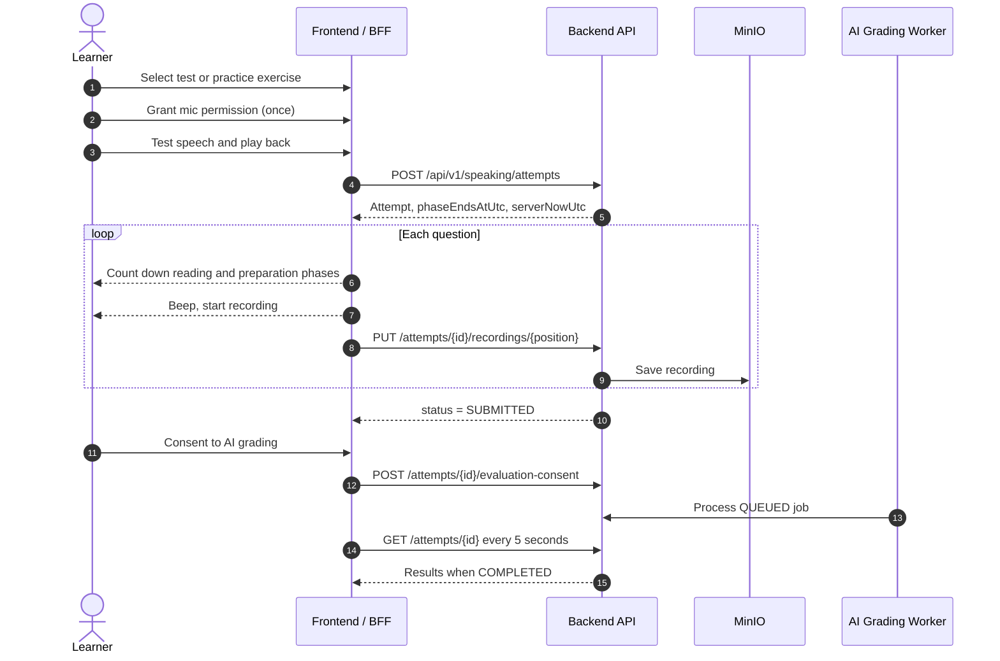

# Feature Specification: TOEIC Speaking Module

> **Status:** ADR-002 step 1, ADR-003, and Test Builder ACs were implemented on 2026-11-21; UAT and calibration are still needed before sign-off.
> **Owner:** Jin MPT  
> **Figma UI Mapping:** Screens 09, 13, 20, 21, 22, 23, 36, 41  
> **Related Documents:**
> - [Admin API](./admin-api.md): Speaking exercise and test bank
> - [Attempt API](./attempt-api.md): taking tests, recording audio, practicing by Part
> - [AI Evaluation](./ai-evaluation.md): grading with Azure Speech and Gemini
> - [Test Builder](./admin-test-builder.md): test builder UI redesign
> - [Execution Checklist](./tasks.md): progress and remaining tasks
> - [ADR-002](../../decisions/002-speaking-test-content-uniqueness.md): no duplicate content within a test
> - [ADR-003](../../decisions/003-speaking-microphone-session.md): one microphone session per attempt
> - [Audit Report](../../runbooks/speaking-audit-report.md), [UAT Runbook](../../runbooks/speaking-uat-runbook.md)
> - PRD sections 4.3.2, 4.4.2, 5.5.1. Historical technical notes: [notespeaking.md](../../../notespeaking.md)

**What agents should read first:** editing test creation → ADR-002 and Test Builder. Editing microphone or recording → ADR-003. Editing grading → AI Evaluation. Editing APIs → Admin API or Attempt API.

---

## 1. Goal & Scope

### Primary Goal
Provide a TOEIC Speaking mock exam and practice room following the ETS format (11 questions, 0–200 scale): the server maintains the timer, automatically records during the response phase, performs AI grading with learner consent, and labels the result as an "estimated score".

### In-scope

**Already implemented**
- [x] Exercise bank across 5 Parts: CRUD, Part 2 images, optimistic concurrency.
- [x] Assemble 7-exercise tests (11 questions) and publish with an immutable snapshot.
- [x] Take full tests, take a test by Part, and practice individual exercises.
- [x] Server timer across `READING → PREPARING → RESPONDING` phases, automatic phase transitions, and resume after page reload.
- [x] Upload recordings per question and play them back during review.
- [x] Authenticated users and anonymous guests.
- [x] Queue-based AI grading: Azure Speech, Gemini, and server-side score calculation.
- [x] Delete guest recordings after 30 days.

**Completed on 2026-11-21**
- [x] Block exact duplicate content in both direct tests and bank-assembled tests: ADR-002 step 1.
- [x] One microphone session per attempt, 3-step device check, and beep sound: ADR-003 (pending real-device UAT).
- [x] Test Builder: two test creation modes, paginated search, position preservation, full error display, save without closing, and test cloning.

### Out-of-scope / Explicit Non-Goals
> [!IMPORTANT]
> The following items are **NOT** part of this feature's scope:
- Do not treat AI scores as official ETS scores.
- Do not configure custom timing per test: `SpeakingTiming` is fixed per ETS, differing from PRD 5.5.1 (see report DOC-04).
- No exam proctoring or anti-cheating enforcement.
- No visual image similarity comparison and no manual "enemy" pair declarations.
- Do not modify Writing, L&R, Auth, or other modules.
- Browsers must not call Azure or Gemini directly.

### Test Structure

| Part | Task Type | Question Positions | Exercises | Questions/Exercise | Reading | Preparation | Response |
| :--- | :--- | :--- | :--- | :--- | :--- | :--- | :--- |
| 1 | Read a text aloud | 1–2 | 2 | 1 | 0 | 45s | 45s |
| 2 | Describe a picture | 3–4 | 2 | 1 | 0 | 45s | 30s |
| 3 | Respond to questions | 5–7 | 1 | 3 | 0 | 3s | 15s, 15s, 30s |
| 4 | Respond using information | 8–10 | 1 | 3 | 45s (before first question) | 3s | 15s, 15s, 30s |
| 5 | Express an opinion | 11 | 1 | 1 | 0 | 45s | 60s |

Total reading, preparation, and response time is 618 seconds.
The "about 20 minutes" figure from [ETS](https://www.ets.org/toeic/about/speaking-writing.html) is the duration of the entire test session.

**Terminology:** an *exercise* is the unit managed by Admins and attached to a test. A *question* is what the candidate answers. One test has **7 exercises** corresponding to **11 questions**.

### Route Mapping

Keep existing routes.
Figma is only a UI reference.

| Figma | Actual Route |
| :--- | :--- |
| 13 `/exams/speaking` | `/speaking` |
| 09 `/practice/speaking/[partId]` | `/speaking/parts/[part]`, `/speaking/exercises/[id]/practice` |
| 20 `/exams/speaking/[id]/device-check` | `/speaking/tests/[id]/practice` |
| 21 `/exams/speaking/[id]/attempt` | `/speaking/attempts/[attemptId]` |
| 22, 23 result and review | `/speaking/attempts/[attemptId]` when `SUBMITTED` |
| 36 `/admin/exercises/speaking/p1` | `/admin/content/speaking` |
| 41 `/admin/exams/speaking` | `/admin/tests/speaking` |

---

## 2. Business Flow

The flow below has been implemented per ADR-003.
The stream is held in the layout; attempt creation happens after the device check.
Part practice has a separate option without recording.



### Step Details
1. **Device check:** only create an attempt after microphone permission is granted and audio has been tested.
2. **Taking the test:** FE counts down using `phaseEndsAtUtc`, but the server is the source of truth for time. When time expires, FE reloads state, and the server automatically advances past all expired phases even if the user was away for a long time.
3. **Recording:** each question has one recording, uploaded when the response phase ends. After the question is locked, there is a 15-second grace period to upload the recording.
4. **Submission:** automatic after the last question, or via `POST /submit`.
5. **AI grading:** not automatic. Runs only after the learner consents because audio is sent to external services.

---

## 3. Data & API Contract

Full contracts: [admin-api.md](./admin-api.md) and [attempt-api.md](./attempt-api.md).
The Speaking section is not yet in `contracts/api-contract.md`.

| Group | Route | Authorization |
| :--- | :--- | :--- |
| Admin | `/api/v1/admin/speaking/*` | JWT, policy `SpeakingAdministration` |
| Learner | `/api/v1/speaking/*` | JWT or header `X-Speaking-Anonymous-Session` |

### Data Tables

| Table | Role | Key Constraints |
| :--- | :--- | :--- |
| `speaking_media_assets` | Images and recordings | Unique `object_key`; includes `sha256` |
| `speaking_exercises` | Exercise bank | Unique `upper(code)`; `(part = 2) = (image_asset_id IS NOT NULL)` |
| `speaking_tests` | Tests | Unique `upper(code)`; `PUBLISHED` requires `published_at_utc` |
| `speaking_test_exercises` | Positions in test | PK `(test_id, part, sequence_number)`; unique `(test_id, exercise_id)`; `snapshot_json` |
| `speaking_attempts` | Attempts | Exactly one owner; exactly one source (`test_id` or `exercise_id`) |
| `speaking_attempt_questions` | Question snapshots | PK `(attempt_id, position)` |
| `speaking_evaluations` | Grading jobs | Unique `attempt_id` |
| `speaking_evaluation_items` | Per-question results | PK `(evaluation_id, position)` |

### Errors & Status Codes
- `400 Bad Request`: invalid input (`ValidationProblemDetails`), or unsupported media format.
- `401 / 403`: unauthenticated or insufficient permissions.
- `404 Not Found`: not found, or caller is not the attempt owner (does not return `403` to avoid leaking existence).
- `409 Conflict`: duplicate code, mismatched `version`, recording upload window expired, or ineligible for AI grading.
- `413 Payload Too Large`: image or recording exceeds size limit.
- `422 Unprocessable Entity`: publish requirements not met, returning per-key errors.
- `429 Too Many Requests`: recording uploads exceed 30 requests per minute.

---

## 4. Edge Cases & Constraints

### Invariants & Business Rules

| # | Rule | Status |
| :--- | :--- | :--- |
| I1 | Published tests cannot be edited; content is served from the snapshot. | Implemented |
| I2 | Publishing a test requires 2/2/1/1/1 exercises, contiguous sequence numbers, matching Part for every exercise, and `PUBLISHED` status. | Implemented |
| I3 | An exercise cannot appear twice in the same test. | Implemented |
| I4 | Attempts keep their own snapshot; editing an exercise or test does not affect in-progress attempts. | Implemented |
| I5 | Upcoming Part 3–4 questions return `null`; Part 4 hides the current question during `READING`. | Implemented |
| I6 | Learners do not receive rubrics or sample answers while taking the test. | Implemented |
| I7 | Server is the source of truth for time; microphone errors do not pause the timer. | Implemented |
| I8 | Each attempt has at most one grading job; the LLM does not decide the final score. | Implemented |
| I9 | No two questions in a test may have duplicate content. | Exact blocking implemented; similarity warning in backlog, ADR-002 |
| I10 | `getUserMedia` is only called inside the provider; FULL attempts are only created after microphone check. | Implemented, ADR-003 |
| I11 | Submitted attempts must not access the microphone. | Implemented, ADR-003 |
| I12 | Full tests require passing the microphone check. Part practice offers a non-recording option. | Implemented |

### Edge Cases

| Case | Current | Target |
| :--- | :--- | :--- |
| Microphone permission denied | Still allows taking the test without recordings | Per I12 |
| Page reload during response phase | Loses in-progress recording with no warning | Warn before leaving page; report missing-recording questions on reopen |
| Microphone unplugged mid-test | Not detected | Warn immediately and attempt recovery |
| Tab closed for a long time then reopened | Server automatically advances phases or submits | Keep as-is |
| Question with no recording | Still submittable; AI grading scores 0 for that question | Keep as-is |
| Entire attempt has no recordings | Consent returns `409` | Keep as-is |
| Clicking AI grading right after submission | `409`, still within 15-second grace period | Keep as-is |
| Exercise inside a draft test gets archived | Publish returns `422` | Add warning when changing exercise status |
| Recording exceeds size limit | `413` | Keep as-is |
| Azure or Gemini unconfigured | Consent returns `409`, UI reports not enabled | Keep as-is |

---

## 5. Acceptance Criteria (Gherkin)

```gherkin
Scenario: Reject publishing or saving an exercise with duplicate questions
  Given a Part 3 exercise where question 1 and question 2 are identical except for casing and punctuation
  When Admin saves the exercise
  Then the system returns 400 with an error on the Questions field

Scenario: Prevent publishing a test with duplicate content across two differently coded exercises
  Given a draft test using two differently coded Part 1 exercises with the same passage
  When Admin publishes the test
  Then the system returns 422 and specifies Question 1 and Question 2
  And the test remains in draft status

Scenario: Prevent publishing a test with the same image in two questions
  Given two Part 2 exercises whose images have the same sha256 but different assets
  When Admin publishes the test
  Then the system returns 422 and specifies Question 3 and Question 4

Scenario: Near-duplicate content only triggers a warning
  Given two Part 1 passages with similarity of 0.8 or higher but not identical
  When Admin checks the test
  Then the result includes a SIMILAR_CONTENT warning
  And Admin can still publish after confirming

Scenario: Request microphone permission only once per attempt
  Given the learner granted permission on the device check screen
  When the learner starts the attempt and progresses through all 11 questions
  Then getUserMedia is called exactly once
  And no other permission prompt appears

Scenario: Prevent creating a full-test attempt without microphone access
  Given the learner denies microphone permission
  When the learner is on the device check screen of a full test
  Then the start button is disabled
  And no POST /attempts request is sent

Scenario: Reviewing a submitted attempt does not use the microphone
  Given the attempt status is SUBMITTED
  When the learner reopens the attempt
  Then getUserMedia is not called

Scenario: Page reload does not automatically trigger a permission prompt
  Given an attempt is in progress and the browser has forgotten the permission
  When the learner reloads the page
  Then no permission prompt appears automatically
  And the learner sees a notice that the timer is still running along with a button to re-enable the microphone

Scenario: Learner completes a Part 1 question
  Given the learner has passed the microphone check and is on question 1
  When the 45-second preparation phase ends
  Then the system plays a beep sound and starts recording
  And when the 45-second response phase ends, the system stops recording and uploads the recording to the server

Scenario: AI score is labeled as estimated
  Given the grading job status is COMPLETED
  When the learner views the results
  Then the score is displayed on a 0–200 scale in steps of 10
  And it clearly states that this is an estimated score, not an ETS score
```
