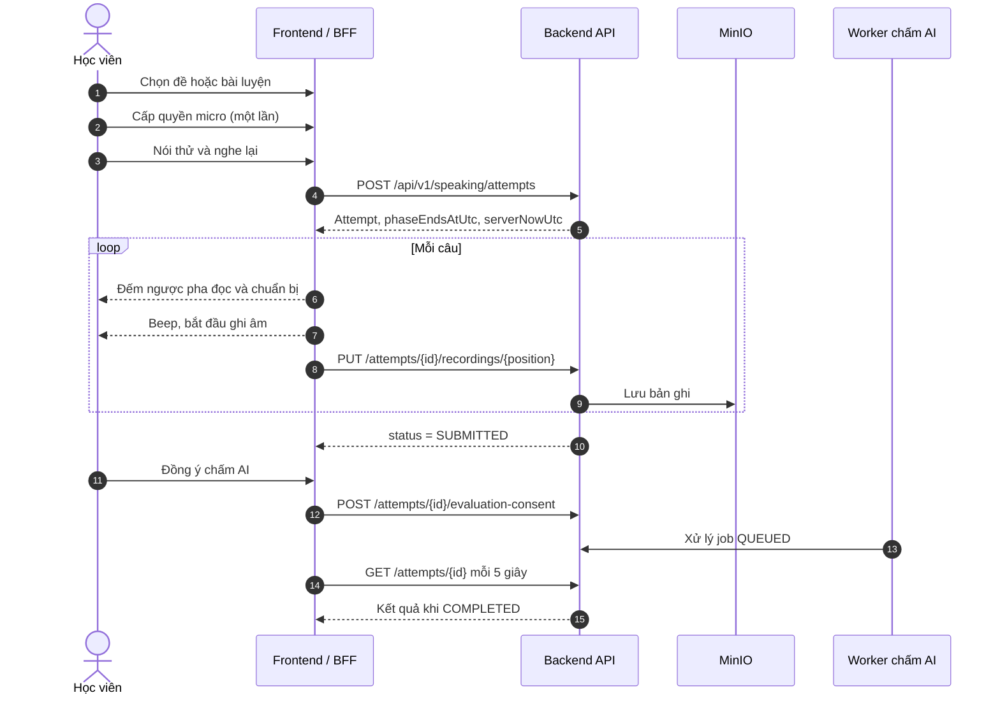

# Feature Specification: TOEIC Speaking Module

> **Trạng thái:** In Review. Backend và FE đã chạy được luồng chính; các mục "Đích" trong tài liệu này chưa triển khai.  
> **Người phụ trách:** Jin MPT  
> **Ánh xạ UI Figma:** Màn hình 09, 13, 20, 21, 22, 23, 36, 41  
> **Tài liệu liên quan:**
> - [Admin API](./admin-api.md): ngân hàng bài tập và đề Speaking
> - [Attempt API](./attempt-api.md): làm bài, ghi âm, luyện theo Part
> - [AI Evaluation](./ai-evaluation.md): chấm điểm bằng Azure Speech và Gemini
> - [Test Builder](./admin-test-builder.md): thiết kế lại UI tạo đề
> - [Execution Checklist](./tasks.md): tiến độ và việc cần làm
> - [ADR-002](../../decisions/002-speaking-test-content-uniqueness.md): không trùng nội dung trong đề
> - [ADR-003](../../decisions/003-speaking-microphone-session.md): một phiên micro cho mỗi lượt làm
> - [Báo cáo rà soát](../../runbooks/speaking-audit-report.md), [UAT Runbook](../../runbooks/speaking-uat-runbook.md)
> - PRD mục 4.3.2, 4.4.2, 5.5.1. Ghi chú kỹ thuật lịch sử: [notespeaking.md](../../../notespeaking.md)

**Agent đọc gì trước:** sửa tạo đề → ADR-002 và Test Builder. Sửa micro hoặc ghi âm → ADR-003. Sửa chấm điểm → AI Evaluation. Sửa API → Admin API hoặc Attempt API.

---

## 1. Mục tiêu & Phạm vi (Goal & Scope)

### Mục tiêu chính
Cung cấp phòng thi thử và luyện tập TOEIC Speaking theo format ETS (11 câu, thang 0–200): server giữ đồng hồ, tự ghi âm trong pha trả lời, chấm AI có sự đồng ý của học viên và có nhãn "điểm ước tính".

### Phạm vi triển khai (In-scope)

**Đã có**
- [x] Ngân hàng bài tập theo 5 Part: CRUD, ảnh Part 2, optimistic concurrency.
- [x] Lắp đề 7 bài (11 câu), công bố kèm snapshot bất biến.
- [x] Làm đề đầy đủ, làm theo Part của đề, luyện từng bài.
- [x] Đồng hồ server qua các pha `READING → PREPARING → RESPONDING`, tự chuyển pha, tiếp tục lại được sau khi tải trang.
- [x] Tải bản ghi theo câu, nghe lại khi xem bài.
- [x] Người dùng đăng nhập và khách ẩn danh.
- [x] Chấm AI theo hàng đợi: Azure Speech, Gemini, server tự tính điểm.
- [x] Xóa bản ghi của khách sau 30 ngày.

**Đích (chưa triển khai)**
- [ ] Không trùng nội dung trong đề: ADR-002.
- [ ] Một phiên micro cho mỗi lượt làm, kiểm tra thiết bị 3 bước, tiếng beep: ADR-003.
- [ ] Test Builder mới: tìm kiếm, giữ vị trí, hiện đủ lỗi, nhân bản đề.

### Ngoài phạm vi (Out-of-scope / Explicit Non-Goals)
> [!IMPORTANT]
> Những phần dưới đây **KHÔNG** làm trong phạm vi tính năng này:
- Không coi điểm AI là điểm ETS chính thức.
- Không cấu hình thời gian theo từng đề: `SpeakingTiming` cố định theo ETS, khác với PRD 5.5.1 (xem báo cáo DOC-04).
- Không giám sát thi (proctoring), không chống gian lận.
- Không so sánh độ giống của ảnh theo hình ảnh và không khai báo cặp "enemy" thủ công.
- Không sửa Writing, L&R, Auth, hoặc các module khác.
- Browser không được gọi trực tiếp Azure hay Gemini.

### Cấu trúc đề

| Part | Dạng bài | Vị trí câu | Số bài | Câu/bài | Đọc | Chuẩn bị | Trả lời |
| :--- | :--- | :--- | :--- | :--- | :--- | :--- | :--- |
| 1 | Read a text aloud | 1–2 | 2 | 1 | 0 | 45s | 45s |
| 2 | Describe a picture | 3–4 | 2 | 1 | 0 | 45s | 30s |
| 3 | Respond to questions | 5–7 | 1 | 3 | 0 | 3s | 15s, 15s, 30s |
| 4 | Respond using information | 8–10 | 1 | 3 | 45s (trước câu đầu) | 3s | 15s, 15s, 30s |
| 5 | Express an opinion | 11 | 1 | 1 | 0 | 45s | 60s |

Tổng đọc, chuẩn bị và trả lời là 618 giây. Con số "khoảng 20 phút" của [ETS](https://www.ets.org/toeic/about/speaking-writing.html) là thời lượng cả bài thi.

**Thuật ngữ:** *bài tập* (exercise) là đơn vị Admin quản lý và là thứ được gắn vào đề. *Câu* (question) là thứ thí sinh trả lời. Một đề có **7 bài** tương ứng **11 câu**.

### Ánh xạ route

Giữ route hiện tại. Figma chỉ là nguồn tham chiếu giao diện.

| Figma | Route thực tế |
| :--- | :--- |
| 13 `/exams/speaking` | `/speaking` |
| 09 `/practice/speaking/[partId]` | `/speaking/parts/[part]`, `/speaking/exercises/[id]/practice` |
| 20 `/exams/speaking/[id]/device-check` | `/speaking/tests/[id]/practice` |
| 21 `/exams/speaking/[id]/attempt` | `/speaking/attempts/[attemptId]` |
| 22, 23 result và review | `/speaking/attempts/[attemptId]` khi `SUBMITTED` |
| 36 `/admin/exercises/speaking/p1` | `/admin/content/speaking` |
| 41 `/admin/exams/speaking` | `/admin/tests/speaking` |

---

## 2. Luồng nghiệp vụ (Business Flow)

Luồng dưới đây là **đích**. Các bước 2, 3 và tiếng beep chưa có; hiện tại bước 2 chỉ xin quyền, và màn làm bài xin quyền thêm một lần (xem ADR-003).



### Chi tiết các bước
1. **Kiểm tra thiết bị:** chỉ tạo lượt làm sau khi có quyền micro và đã kiểm tra âm thanh.
2. **Làm bài:** FE đếm ngược theo `phaseEndsAtUtc`, nhưng server mới là nguồn thời gian. Khi hết giờ FE tải lại, và server tự chuyển qua mọi pha đã quá hạn, kể cả khi người dùng vắng lâu.
3. **Ghi âm:** mỗi câu có một bản ghi, tải lên khi hết pha trả lời. Sau khi khóa câu còn 15 giây ân hạn để tải bản ghi.
4. **Nộp bài:** tự động sau câu cuối, hoặc qua `POST /submit`.
5. **Chấm AI:** không tự động. Chỉ chạy sau khi học viên đồng ý vì giọng nói được gửi ra dịch vụ ngoài.

---

## 3. Giao ước Dữ liệu & API (Data & API Contract)

Hợp đồng đầy đủ: [admin-api.md](./admin-api.md) và [attempt-api.md](./attempt-api.md). Mục Speaking chưa có trong `contracts/api-contract.md`.

| Nhóm | Route | Quyền |
| :--- | :--- | :--- |
| Quản trị | `/api/v1/admin/speaking/*` | JWT, policy `SpeakingAdministration` |
| Học viên | `/api/v1/speaking/*` | JWT hoặc header `X-Speaking-Anonymous-Session` |

### Bảng dữ liệu

| Bảng | Vai trò | Ràng buộc chính |
| :--- | :--- | :--- |
| `speaking_media_assets` | Ảnh và bản ghi | `object_key` duy nhất; có `sha256` |
| `speaking_exercises` | Ngân hàng bài | `upper(code)` duy nhất; `(part = 2) = (image_asset_id IS NOT NULL)` |
| `speaking_tests` | Đề | `upper(code)` duy nhất; `PUBLISHED` thì phải có `published_at_utc` |
| `speaking_test_exercises` | Vị trí trong đề | PK `(test_id, part, sequence_number)`; duy nhất `(test_id, exercise_id)`; `snapshot_json` |
| `speaking_attempts` | Lượt làm | Đúng một owner; đúng một nguồn `test_id` hoặc `exercise_id` |
| `speaking_attempt_questions` | Snapshot từng câu | PK `(attempt_id, position)` |
| `speaking_evaluations` | Job chấm | `attempt_id` duy nhất |
| `speaking_evaluation_items` | Kết quả từng câu | PK `(evaluation_id, position)` |

### Xử lý lỗi (Errors & Status Codes)
- `400 Bad Request`: dữ liệu không hợp lệ (`ValidationProblemDetails`), hoặc media sai định dạng.
- `401 / 403`: chưa đăng nhập hoặc không đủ quyền.
- `404 Not Found`: không tìm thấy, hoặc không phải chủ lượt làm (không trả `403` để tránh lộ sự tồn tại).
- `409 Conflict`: trùng mã, sai `version`, hết thời gian tải bản ghi, hoặc chưa đủ điều kiện chấm AI.
- `413 Payload Too Large`: ảnh hoặc bản ghi quá dung lượng.
- `422 Unprocessable Entity`: chưa đủ điều kiện công bố, trả từng lỗi theo khóa.
- `429 Too Many Requests`: tải bản ghi quá 30 lần mỗi phút.

---

## 4. Ràng buộc & Ngoại lệ (Edge Cases & Constraints)

### Ràng buộc bất biến (Invariants & Business Rules)

| # | Quy tắc | Trạng thái |
| :--- | :--- | :--- |
| I1 | Đề đã công bố không sửa được; nội dung lấy từ snapshot. | Đã có |
| I2 | Đề công bố cần đủ 2/2/1/1/1 bài, số thứ tự liên tục, mọi bài đúng Part và `PUBLISHED`. | Đã có |
| I3 | Một bài không xuất hiện hai lần trong một đề. | Đã có |
| I4 | Lượt làm giữ snapshot riêng; sửa bài hoặc đề không ảnh hưởng lượt đã bắt đầu. | Đã có |
| I5 | Câu hỏi Part 3–4 chưa đến lượt trả về `null`; Part 4 ẩn câu hiện tại khi đang `READING`. | Đã có |
| I6 | Học viên không nhận rubric hay bài mẫu khi đang làm bài. | Đã có |
| I7 | Server là nguồn thời gian; lỗi micro không dừng đồng hồ. | Đã có |
| I8 | Mỗi lượt làm có tối đa một job chấm; LLM không quyết định điểm cuối. | Đã có |
| I9 | Không có hai câu trùng nội dung trong đề: chặn trùng chính xác, cảnh báo gần giống. | **Đích**, ADR-002 |
| I10 | `getUserMedia` chỉ được gọi từ một nơi; lượt làm chỉ được tạo sau khi có micro. | **Đích**, ADR-003 |
| I11 | Bài đã nộp không được dùng đến micro. | **Đích**, ADR-003 |
| I12 | Đề đầy đủ bắt buộc qua kiểm tra micro. Luyện Part có lựa chọn không ghi âm. | **Đích**, chờ D1 |

### Các trường hợp biên (Edge Cases)

| Trường hợp | Hiện tại | Đích |
| :--- | :--- | :--- |
| Từ chối quyền micro | Vẫn cho làm bài, không có bản ghi | Theo I12 |
| Tải lại trong pha trả lời | Mất phần đang ghi, không cảnh báo | Có cảnh báo trước khi rời trang, báo câu thiếu bản ghi khi mở lại |
| Rút micro giữa bài | Không phát hiện | Cảnh báo ngay, thử khôi phục |
| Đóng tab lâu rồi mở lại | Server tự chuyển pha hoặc nộp bài | Giữ nguyên |
| Câu không có bản ghi | Vẫn nộp được; chấm AI cho 0 điểm câu đó | Giữ nguyên |
| Cả bài không có bản ghi | Consent trả `409` | Giữ nguyên |
| Bấm chấm AI ngay sau khi nộp | `409`, còn trong 15 giây ân hạn | Giữ nguyên |
| Bài trong đề nháp bị lưu trữ | Công bố trả `422` | Thêm cảnh báo khi đổi trạng thái bài |
| Bản ghi vượt giới hạn | `413` | Giữ nguyên |
| Azure hoặc Gemini chưa cấu hình | Consent trả `409`, UI báo chưa bật | Giữ nguyên |

---

## 5. Tiêu chí nghiệm thu (Acceptance Criteria - Gherkin)

```gherkin
Scenario: Không công bố đề có câu hỏi trùng trong một bài
  Given bài Part 3 có câu 1 và câu 2 giống nhau, chỉ khác hoa thường và dấu câu
  When Admin lưu bài tập
  Then hệ thống trả 400 với lỗi ở trường Questions

Scenario: Không công bố đề có nội dung trùng giữa hai bài khác mã
  Given đề nháp dùng hai bài Part 1 khác mã nhưng cùng đoạn văn
  When Admin công bố đề
  Then hệ thống trả 422 và chỉ rõ Câu 1 và Câu 2
  And đề vẫn ở trạng thái nháp

Scenario: Không công bố đề có cùng ảnh ở hai câu
  Given hai bài Part 2 có ảnh cùng sha256 nhưng khác asset
  When Admin công bố đề
  Then hệ thống trả 422 và chỉ rõ Câu 3 và Câu 4

Scenario: Nội dung gần giống chỉ cảnh báo
  Given hai đoạn văn Part 1 có độ giống từ 0,8 trở lên nhưng không trùng hoàn toàn
  When Admin kiểm tra đề
  Then kết quả có cảnh báo SIMILAR_CONTENT
  And Admin vẫn công bố được sau khi xác nhận

Scenario: Chỉ xin quyền micro một lần trong lượt làm
  Given học viên đã cấp quyền ở màn kiểm tra
  When học viên bắt đầu làm và đi qua cả 11 câu
  Then getUserMedia chỉ được gọi đúng một lần
  And không có hộp thoại quyền nào khác xuất hiện

Scenario: Không tạo lượt làm khi chưa có micro ở đề đầy đủ
  Given học viên từ chối quyền micro
  When học viên ở màn kiểm tra của đề đầy đủ
  Then nút bắt đầu bị khóa
  And không có request POST /attempts nào được gửi

Scenario: Xem lại bài đã nộp không dùng micro
  Given lượt làm đã SUBMITTED
  When học viên mở lại lượt làm
  Then getUserMedia không được gọi

Scenario: Tải lại trang không tự hiện hộp thoại quyền
  Given lượt làm đang chạy và trình duyệt đã quên quyền
  When học viên tải lại trang
  Then không có hộp thoại quyền tự xuất hiện
  And học viên thấy thông báo đồng hồ vẫn chạy kèm nút bật lại micro

Scenario: Học viên hoàn thành câu Part 1
  Given học viên đã qua kiểm tra micro và đang ở câu 1
  When hết 45 giây chuẩn bị
  Then hệ thống phát tiếng beep và bắt đầu ghi âm
  And khi hết 45 giây trả lời, hệ thống dừng ghi và tải bản ghi lên server

Scenario: Điểm AI có nhãn ước tính
  Given job chấm đã COMPLETED
  When học viên xem kết quả
  Then điểm hiển thị trên thang 0–200, bước 10
  And có ghi rõ đây là điểm ước tính, không phải điểm ETS
```
