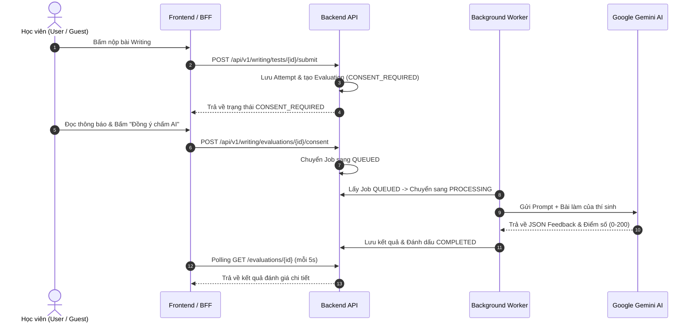

# Feature Specification: TOEIC Writing Module

> **Trạng thái:** Production Ready / In Use  
> **Phạm vi kỹ năng:** TOEIC Writing (Part 1: 5 câu, Part 2: 2 câu, Part 3: 1 câu)  
> **Tài liệu chi tiết liên quan:**
> - [Admin API](./admin-api.md) — Quản lý ngân hàng câu hỏi & đề thi Writing
> - [Attempt API](./attempt-api.md) — Làm bài thi, hỗ trợ người dùng đăng nhập & Anonymous
> - [AI Evaluation](./ai-evaluation.md) — Kiến trúc hàng đợi chấm điểm AI với Google Gemini
> - [UAT Runbook](../../runbooks/writing-uat-runbook.md) — Kịch bản kiểm thử UAT và checklist bàn giao

---

## 1. Mục tiêu & Phạm vi (Goal & Scope)

### Mục tiêu chính
Cung cấp phân hệ luyện thi và thi thử TOEIC Writing chuẩn cấu trúc ETS gồm 8 câu hỏi, hỗ trợ chấm điểm tự động bằng mô hình AI Gemini (0–200 điểm, ước tính theo rubric ETS), kèm giải thích và bài mẫu.

### Phạm vi triển khai (In-scope)
- [x] **Ngân hàng bài tập Admin (`/api/v1/admin/writing/exercises`):** Quản lý câu hỏi Part 1 (Write sentence based on picture), Part 2 (Respond to written request), Part 3 (Write an opinion essay).
- [x] **Luồng làm bài học viên (`/api/v1/writing`):** 
  - Đề thi chỉ trả câu hỏi đã `PUBLISHED`, tuyệt đối không lộ đáp án mẫu (model answer) hay rubric chấm điểm.
  - Hỗ trợ cả thành viên đăng nhập (JWT `sub`) và khách vãng lai qua Header `X-Writing-Anonymous-Session` (server lưu SHA-256).
- [x] **Chấm điểm bằng AI Gemini (Hàng đợi bền vững):**
  - Chuyển trạng thái an toàn: `CONSENT_REQUIRED` -> `QUEUED` -> `PROCESSING` -> `COMPLETED`/`FAILED`.
  - Cơ chế kiểm soát quota Gemini Free Tier: Người dùng ẩn danh chỉ được tạo 1 lượt chấm mới trong mỗi 24 giờ.

### Ngoài phạm vi (Explicit Non-Goals)
> [!IMPORTANT]
> - Không dùng điểm AI làm kết quả thi chứng chỉ ETS chính thức (luôn ghi chú: "Điểm TOEIC Writing ước tính bởi AI").
> - Không cho phép browser gọi trực tiếp Google Gemini API (toàn bộ key và lời gọi AI được đóng gói bảo mật tại backend worker).

---

## 2. Luồng nghiệp vụ Chấm điểm AI (Business Flow)

---

## 3. Ràng buộc Kỹ thuật & Bảo mật cốt lõi (Guardrails)

1. **Bảo mật đề thi & Model Answer:**
   - Client không bao giờ nhận được model answer trước khi hoàn thành bài thi và có kết quả đánh giá.
2. **Phiên ẩn danh an toàn (Anonymous Ownership):**
   - Định danh khách vãng lai thông qua header `X-Writing-Anonymous-Session`. Backend chỉ lưu hash SHA-256, không bao giờ lưu UUID thô.
   - Một attempt chỉ thuộc về một chủ sở hữu duy nhất. Người khác truy cập sẽ nhận `404 Not Found` (không trả `403` để tránh rò rỉ sự tồn tại của attempt).
3. **Bảo vệ Quota AI:**
   - Áp dụng rate limit 24h đối với khách vãng lai.
   - Thao tác Retry của **cùng một attempt** bị lỗi không bị tính vào hạn mức mới.
