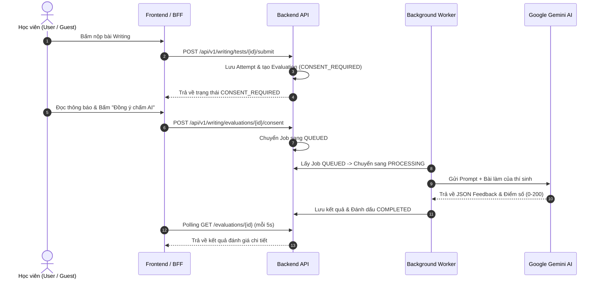

# Feature Specification: TOEIC Writing Module

> **Trạng thái:** Production Ready / In Use (Đang nâng cấp tính năng Tạo đề độc lập & Import Excel)  
> **Phạm vi kỹ năng:** TOEIC Writing (Part 1: 5 câu, Part 2: 2 câu, Part 3: 1 câu)  
> **Ánh xạ Figma & Routes Frontend:**
> - `/admin/content/writing` (Figma Màn hình 38, 39) — Ngân hàng câu hỏi lẻ theo Part
> - `/admin/tests/writing` (Figma Màn hình 42) — Quản lý & Tạo đề thi Writing độc lập
> - `/writing` (Figma Màn hình 11, 14) — Thư viện đề thi Writing & Luyện tập
> - `/writing/tests/[id]` (Figma Màn hình 24) — Hướng dẫn thi & Cấu trúc Timing
> - `/writing/attempts/[id]` (Figma Màn hình 25) — Phòng thi ảo 2-Phase (Chuẩn bị ➜ Làm bài)
> - `/writing/attempts/[id]/result` (Figma Màn hình 26, 27) — Kết quả thi, Báo cáo chấm AI & Bài mẫu
> - `/history/writing` (Figma Màn hình 06) — Lịch sử làm bài thi Writing
>
> **Tài liệu chi tiết liên quan:**
> - [Admin API](./admin-api.md) — Quản lý ngân hàng câu hỏi, tạo đề độc lập & Import Excel đề thi
> - [Attempt API](./attempt-api.md) — Làm bài thi, hỗ trợ người dùng đăng nhập & Anonymous
> - [AI Evaluation](./ai-evaluation.md) — Kiến trúc hàng đợi chấm điểm AI với Google Gemini
> - [Giao ước API Tổng thể](../../contracts/api-contract.md#quản-trị-đề-toeic-writing--ngân-hàng-câu-hỏi) — Single Source of Truth (SSoT)
> - [UAT Runbook](../../runbooks/writing-uat-runbook.md) — Kịch bản kiểm thử UAT và checklist bàn giao

---

## 1. Mục tiêu & Phạm vi (Goal & Scope)

### Mục tiêu chính
Cung cấp phân hệ luyện thi và thi thử TOEIC Writing chuẩn cấu trúc ETS gồm 8 câu hỏi, hỗ trợ chấm điểm tự động bằng mô hình AI Gemini (0–200 điểm, ước tính theo rubric ETS), kèm giải thích và bài mẫu.

### Phạm vi triển khai (In-scope)
- [x] **Ngân hàng bài tập lẻ độc lập (`/api/v1/admin/writing/exercises` / UI: `/admin/content/writing`):** 
  - Hoạt động độc lập với Đề thi, phục vụ riêng cho tính năng học viên Luyện tập theo từng Part (`/practice/writing/[partId]`).
  - Quản lý câu hỏi Part 1 (Write sentence based on picture), Part 2 (Respond to written request), Part 3 (Write an opinion essay).
  - Hỗ trợ Import câu hỏi lẻ theo Part bằng file Excel (`POST /exercises/imports/validate?part={1|2|3}`).
- [x] **Quản lý Đề thi Writing độc lập (`/api/v1/admin/writing/tests` / UI: `/admin/tests/writing`):**
  - **Tạo đề thi mới hoàn toàn (Direct Exam Creation):** Nhập trực tiếp trọn gói 8 câu hỏi trong đề thi (5 câu Part 1, 2 câu Part 2, 1 câu Part 3) mà không cần nhặt câu hỏi từ Ngân hàng bài tập lẻ.
  - **Import đề thi bằng file Excel trọn gói:** Bổ sung cơ chế import toàn bộ 8 câu hỏi kèm metadata của một đề thi hoàn chỉnh từ file `.xlsx` (`POST /api/v1/admin/writing/tests/import`).
  - **Vòng đời đề thi an toàn:** Đề tạo ở trạng thái `DRAFT` ➜ Soạn thảo/Chỉnh sửa ➜ Kiểm tra điều kiện đủ 8 câu đúng cấu trúc (5/2/1) ➜ `PUBLISHED` ➜ Nội dung đóng băng bất biến (Immutable snapshot).
- [x] **Luồng làm bài học viên (`/api/v1/writing`):** 
  - Đề thi chỉ trả câu hỏi đã `PUBLISHED`, tuyệt đối không lộ đáp án mẫu (model answer) hay rubric chấm điểm.
  - Hỗ trợ cả thành viên đăng nhập (JWT `sub`) và khách vãng lai qua Header `X-Writing-Anonymous-Session` (server lưu SHA-256).
  - Phòng thi 2-Phase theo từng câu (Chuẩn bị ➜ Làm bài), Editor khóa trong pha chuẩn bị, tự động lưu autosave (debounce 800ms).
- [x] **Chấm điểm bằng AI Gemini (Hàng đợi bền vững):**
  - Chuyển trạng thái an toàn: `CONSENT_REQUIRED` -> `QUEUED` -> `PROCESSING` -> `COMPLETED`/`FAILED`.
  - Cơ chế kiểm soát quota Gemini Free Tier: Người dùng ẩn danh chỉ được tạo 1 lượt chấm mới trong mỗi 24 giờ.

### Ngoài phạm vi (Explicit Non-Goals)
> [!IMPORTANT]
> - Không dùng điểm AI làm kết quả thi chứng chỉ ETS chính thức (luôn ghi chú: "Điểm TOEIC Writing ước tính bởi AI").
> - Không cho phép browser gọi trực tiếp Google Gemini API (toàn bộ key và lời gọi AI được đóng gói bảo mật tại backend worker).
> - Đề thi (`WritingTest`) và Ngân hàng bài tập lẻ (`WritingExercise`) không chia sẻ phụ thuộc cứng (tight coupling): sửa/xóa bài tập lẻ không làm ảnh hưởng đến đề thi đã xuất bản.

---

## 2. Luồng nghiệp vụ Chấm điểm AI (Business Flow)



---

## 3. Ràng buộc Kỹ thuật & Bảo mật cốt lõi (Guardrails)

1. **Bảo mật đề thi & Model Answer:**
   - Client không bao giờ nhận được model answer trước khi hoàn thành bài thi và có kết quả đánh giá.
2. **Phiên ẩn danh an toàn (Anonymous Ownership):**
   - Định danh khách vãng lai thông qua header `X-Writing-Anonymous-Session`. Backend chỉ lưu hash SHA-256, không bao giờ lưu UUID thô.
   - Một attempt chỉ thuộc về một chủ sở hữu duy nhất. Người khác truy cập sẽ nhận `404 Not Found` (không trả `403` để tránh rò rỉ sự tồn tại của attempt).
3. **Bảo vệ Quota AI:**
   - Áp dụng rate limit 24h đối với khách vãng lai.
   - Thao tác Retry của **cùng một attempt** bị lỗi không bị tính vào hạn mức mới.
4. **Tính toàn vẹn & Bất biến của Đề thi (Exam Immutability):**
   - Đề thi Writing sau khi `PUBLISHED` là bất biến. Không cho phép sửa đổi câu hỏi của đề đã xuất bản để đảm bảo kết quả làm bài của học viên trong quá khứ không bị sai lệch.
   - Ngân hàng bài tập lẻ (`WritingExercise`) và Đề thi (`WritingTest`) độc lập hoàn toàn, không có ràng buộc khóa ngoại cứng gây xóa theo dòng (cascade delete/update).

---

## 4. Tiêu chí nghiệm thu (Acceptance Criteria)

```gherkin
Scenario: Admin tạo đề thi Writing độc lập mới hoàn toàn
  Given Admin nhập đầy đủ thông tin đề thi và 8 câu hỏi (5 câu Part 1, 2 câu Part 2, 1 câu Part 3)
  When Admin lưu đề ở trạng thái DRAFT
  Then hệ thống lưu trữ toàn bộ 8 câu hỏi gắn liền với đề thi mà không cần tham chiếu ngân hàng câu hỏi lẻ
  And khi bấm PUBLISH, hệ thống kiểm tra đủ điều kiện và đóng băng nội dung thành phiên bản bất biến

Scenario: Admin import đề thi Writing hoàn chỉnh từ file Excel
  Given Admin có file Excel đúng cấu trúc template gồm đầy đủ thông tin đề và 8 câu hỏi (5/2/1) kèm hình ảnh Part 1 đã upload
  When Admin gọi POST /api/v1/admin/writing/tests/import
  Then hệ thống tạo một đề thi Writing mới hoàn chỉnh ở trạng thái DRAFT với đầy đủ 8 câu hỏi

Scenario: Học viên làm bài thi Writing và yêu cầu chấm điểm AI
  Given học viên vào phòng thi ảo với đề thi đã PUBLISHED
  When học viên trải qua các câu hỏi theo 2 pha (Chuẩn bị -> Làm bài) và nộp bài
  Then hệ thống lưu attempt và cho phép học viên gửi yêu cầu chấm điểm AI (Consent)
  And AI Background Worker tiến hành đánh giá và trả về điểm số ước tính 0-200 cùng feedback chi tiết
```
