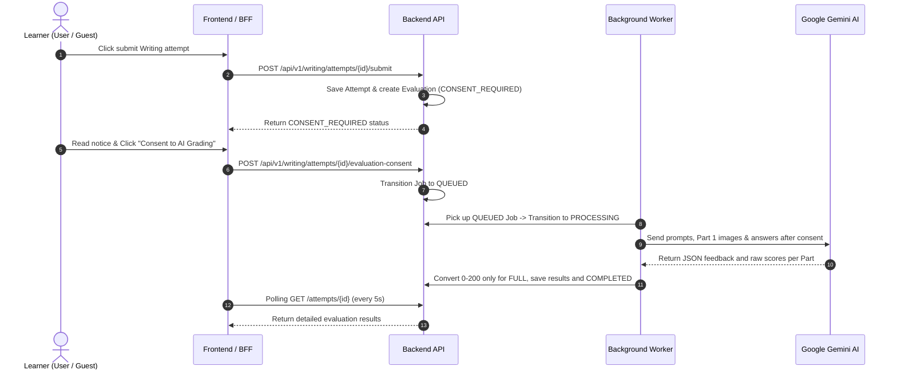

# Feature Specification: TOEIC Writing Module

> **Status:** Integration testing and UAT needed after migration
> **Skill Scope:** TOEIC Writing (Part 1: 5 questions, Part 2: 2 questions, Part 3: 1 question)  
> **Figma Mapping & Frontend Routes:**
> - `/admin/content/writing` (Figma Screens 38, 39) - Standalone question bank by Part
> - `/admin/tests/writing` (Figma Screen 42) - Manage & Create standalone Writing tests
> - `/writing` (Figma Screens 11, 14) - Writing Test Library & Practice
> - `/writing/tests/[id]` (Figma Screen 24) - Test Instructions & Timing Structure
> - `/writing/attempts/[id]` (Figma Screen 25) - 2-Phase Virtual Test Room (Preparation ➜ Answering)
> - `/writing/attempts/[id]/result` (Figma Screens 26, 27) - Results and AI Grading Report
> - `/writing/practice/[part]` - Standalone exercise practice by Part
> - `/history/writing` (Figma Screen 06) - Writing Test History
>
> **Related Detailed Documentation:**
> - [Admin API](./admin-api.md) - Manage question bank, create standalone tests & Excel test import
> - [Attempt API](./attempt-api.md) - Taking tests, supporting signed-in users & Anonymous
> - [AI Evaluation](./ai-evaluation.md) - Durable AI grading queue architecture with Google Gemini
> - [Overall API Contract](../../contracts/api-contract.md#toeic-writing-test-and-question-bank-administration) - Single Source of Truth (SSoT)
> - [UAT Runbook](../../runbooks/writing-uat-runbook.md) - UAT test scenarios and handoff checklist

---

## 1. Goal & Scope

### Primary Goal
Provide a TOEIC Writing practice and mock-test module with 8 questions, supporting automatic grading via Gemini and rubric-based feedback. The 0-200 test score is an AI estimate for practice only; standalone exercises display raw scores per Part.

### Implementation Scope (In-scope)
- [x] **Standalone Exercise Bank (`/api/v1/admin/writing/exercises` / UI: `/admin/content/writing`):** 
  - Standalone exercises serve Part-based practice (`/writing/practice/[part]`) and are independent of directly entered tests.
  - Manage Part 1 (Write sentence based on picture), Part 2 (Respond to written request), and Part 3 (Write an opinion essay) questions.
  - Support importing standalone questions by Part via Excel file (`POST /exercises/imports/validate?part={1|2|3}`).
- [x] **Standalone Writing Test Management (`/api/v1/admin/writing/tests` / UI: `/admin/tests/writing`):**
  - **Direct Exam Creation:** Directly enter all 8 questions of a test (5 Part 1 questions, 2 Part 2 questions, 1 Part 3 question) without needing to pick questions from the standalone exercise bank.
  - **Full-Test Excel Import:** Added a mechanism to import all 8 questions along with metadata of a complete test from an `.xlsx` file (`POST /api/v1/admin/writing/tests/import`).
  - **Safe Test Lifecycle:** Tests created in `DRAFT` status can be edited or deleted; once 8 questions with the valid structure (5/2/1) are present, they can be `PUBLISHED` and content is frozen. Admins can archive (`ARCHIVED`) or restore back to `PUBLISHED`; history and started attempts are preserved.
- [x] **Learner Attempt Flow (`/api/v1/writing`):** 
  - Tests only return `PUBLISHED` questions and never expose the model answer or grading rubric.
  - Supports both signed-in members (JWT `sub`) and guests via the `X-Writing-Anonymous-Session` header (server stores SHA-256).
  - 2-Phase test room per question (Preparation ➜ Answering), Editor locked during the preparation phase, automatic autosave (800ms debounce).
- [x] **AI Grading with Google Gemini (Durable Queue):**
  - Safe state transitions: `CONSENT_REQUIRED` -> `QUEUED` -> `PROCESSING` -> `COMPLETED`/`FAILED`.
  - Gemini Free Tier quota control mechanism: Anonymous users can only create 1 new grading attempt per 24 hours.

### Out of Scope (Explicit Non-Goals)
> [!IMPORTANT]
> - Do not use AI scores as official ETS certification test results (always note: "AI-estimated TOEIC Writing score").
> - Do not allow the browser to call the Google Gemini API directly (all keys and AI calls are securely encapsulated in the backend worker).
> - Tests (`WritingTest`) and the standalone exercise bank (`WritingExercise`) do not share tight coupling: editing or deleting a standalone exercise does not affect published tests.

---

## 2. AI Grading Business Flow



---

## 3. Core Technical & Security Guardrails

1. **Test & Model Answer Security:**
   - `modelAnswer` is optional Admin reference information; the learner API does not return model answers.
2. **Secure Anonymous Ownership:**
   - Guest identification via the `X-Writing-Anonymous-Session` header. The backend only stores the SHA-256 hash and never stores raw UUIDs.
   - An attempt belongs to a single owner only. Other users accessing it receive `404 Not Found` (do not return `403` to avoid leaking the existence of the attempt).
3. **AI Quota Protection:**
   - Apply a 24h rate limit for guests.
   - Retrying the **same failed attempt** does not count against the new quota.
4. **Exam Integrity & Immutability:**
   - Once `PUBLISHED`, a Writing test is immutable. Editing questions on a published test is not permitted, ensuring past learner attempt results are not skewed.
   - Directly entered tests are independent of the bank; legacy tests using `exerciseId` are still supported to preserve backward compatibility.

---

## 4. Acceptance Criteria

```gherkin
Scenario: Admin creates a completely new standalone Writing test
  Given Admin enters complete test info and 8 questions (5 Part 1, 2 Part 2, 1 Part 3)
  When Admin saves the test in DRAFT status
  Then the system stores all 8 questions attached to the test without referencing the standalone question bank
  And when clicking PUBLISH, the system validates completeness and freezes the content into an immutable version

Scenario: Admin imports a complete Writing test from an Excel file
  Given Admin has an Excel file matching the template structure with full test info and 8 questions (5/2/1) along with uploaded Part 1 images
  When Admin calls POST /api/v1/admin/writing/tests/import
  Then the system creates a complete new Writing test in DRAFT status with all 8 questions

Scenario: Learner takes a Writing test and requests AI grading
  Given a learner enters the virtual test room with a PUBLISHED test
  When the learner progresses through questions in 2 phases (Preparation -> Answering) and submits the attempt
  Then the system stores the attempt and allows the learner to submit an AI grading request (Consent)
  And the AI Background Worker evaluates and returns an estimated 0-200 score along with detailed feedback
```
