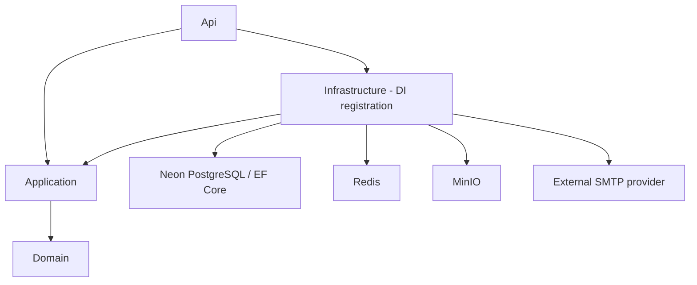
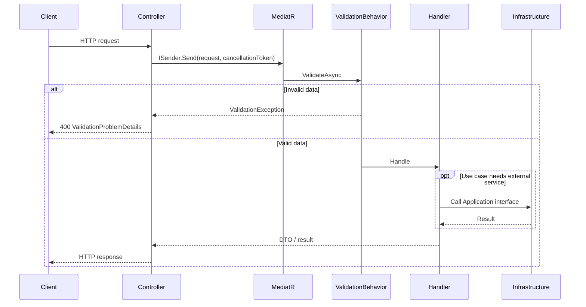

# Clean Architecture

The backend is an ASP.NET Core application deployed as a single unit. CQRS separates commands (writes/performing actions) and queries (reads) within the same application; it currently still uses a single Neon database. MediatR dispatches requests in-process, not via a message broker.

## Dependency Direction



Arrows between projects represent compile-time dependencies. Domain does not reference other projects or NuGet packages. Application only references Domain; Infrastructure implements interfaces defined by Application. API references Infrastructure for DI registration in `Program.cs`; controllers call Application via `ISender`.

| Project        | Place code here                                                               | Boundary                                                        |
| -------------- | ----------------------------------------------------------------------------- | --------------------------------------------------------------- |
| Domain         | Entities, value objects, business rules                                       | Independent of ASP.NET, EF Core, and adapters                   |
| Application    | Commands/queries, handlers, validators, DTOs, interfaces                      | No DbContext, HTTP context, or Redis/MinIO/SMTP clients         |
| Infrastructure | DbContext, EF configurations/migrations, data/cache/storage/email adapters    | Implements Application interfaces                               |
| Api            | Controllers, HTTP request/response, HTTP mapping, exception handlers, DI      | No business logic or DbContext access in controllers            |

## Request Flow



`ValidationBehavior` runs validators asynchronously and sequentially before the handler. This supports `MustAsync` and avoids concurrent execution of multiple validators sharing a scoped DbContext. Requests and validators must forward the cancellation token. Errors are grouped by property into `errors`; ProblemDetails includes `traceId` for log lookup.

## Use Case Organization

```text
Application/
  Common/Behaviors/ValidationBehavior.cs
  DependencyInjection.cs
  Email/
    IMailSender.cs
    Commands/SendEmail/
      SendEmailCommand.cs
      SendEmailCommandValidator.cs
  System/Queries/GetSystemStatus/
    GetSystemStatusQuery.cs
Api/
  Controllers/
  Mapping/SystemProfile.cs
  ExceptionHandling/ValidationExceptionHandler.cs
```

When adding a feature, create a folder by business domain, for example `Exams/Commands/SubmitExam` or `Exams/Queries/GetExam`. Each use case contains the required request, handler, DTO, and validator; they may be split into separate files as code grows longer.

1. Place business rules and entities in Domain.
2. Create a command/query using `IRequest<TResponse>` and a handler using `IRequestHandler<TRequest, TResponse>` in Application.
3. For input data, create an `AbstractValidator<TRequest>`. DI automatically discovers handlers, validators, and mapping profiles in Application.
4. If a database or external service is needed, define a use-case-specific interface in Application and implement it in Infrastructure. Register the implementation in `AddInfrastructure`.
5. The controller converts the HTTP request into a command/query, calls `ISender.Send`, and returns an HTTP response.
6. Add tests for business rules, invalid data, and controlled side effects.

Existing read sample: `GET /api/v1/system/ping` → `GetSystemStatusQueryHandler` → `SystemStatusDto` → `SystemProfile` → `PingResponse`. The FE contract remains `{ "service": "TOEICMaster", "status": "ok" }`.

Existing command sample: `SendEmailCommand` → `SendEmailCommandValidator` → `SendEmailCommandHandler` → `IMailSender` → `SmtpMailSender`. This command serves internal use cases and tests; there is no HTTP endpoint for sending mail yet. Current limits are 254 characters for recipient, 200 characters for subject, and 100,000 characters for text body.

## Libraries and Conventions

- **MediatR:** uses `ISender` in controllers to dispatch commands/queries. CQRS is a pattern; no separate package is mandatory.
- **FluentValidation:** uses the core package and DI extensions; validation runs in the MediatR pipeline. Do not use `FluentValidation.AspNetCore` auto-validation because the MVC pipeline does not support async and that package is no longer maintained. [Official guide](https://docs.fluentvalidation.net/en/latest/aspnet.html).
- **AutoMapper:** Domain → Application DTO profiles live in Application; Application DTO → HTTP response profiles live in Api. DI scans both assemblies. Mapping into an entity with business rules must go through the entity's constructor/methods to protect state; do not arbitrarily map input onto entities.
- **EF Core:** DbContext, configurations, and migrations live in Infrastructure. Read-only queries should use `AsNoTracking`, pagination, and select only needed fields. Create business-specific data access interfaces when use cases require them; do not add a generic repository or global transaction behavior before transaction boundaries are defined.

AutoMapper already integrates `AddAutoMapper`; MediatR already integrates `AddMediatR`. Do not install legacy `*.Extensions.Microsoft.DependencyInjection` packages. [AutoMapper DI](https://docs.automapper.io/en/stable/Dependency-injection.html), [MediatR DI](https://github.com/LuckyPennySoftware/MediatR#registering-with-iservicecollection).

## Testing and Configuration

The test project is organized into folders following the same Clean Architecture boundaries: `Architecture`, `Application`,
`Infrastructure`, and `Api`. Shared fakes live in `TestDoubles` so test cases do not depend on each other through the root
namespace. Tests check project references, Domain/Application dependencies, MediatR dispatch and validation,
cancellation, HTTP ProblemDetails, mapping configuration, the ping contract, CORS, and the SMTP adapter. Tests use a fake
mail adapter or local SMTP server; real Neon credentials are not required.

Neon credentials and license keys live in user secrets or environment variables. See the README for setup. DI does not expose license keys in HTTP responses or logs and does not suppress library license warnings.

The account registration flow places `RegisterCommand`, `VerifyEmailCommand`, and `ResendEmailVerificationCommand` in
Application. `User` and `EmailVerificationChallenge` live in Domain; EF/BCrypt/HMAC/SMTP adapters live in
Infrastructure. Local accounts start in an unactivated state; PostgreSQL only stores the HMAC of the 6-digit OTP, attempt count,
expiration, and resend cooldown. Login uses `LoginCommand`; JWT and random refresh tokens are issued by the Infrastructure adapter. Domain
manages `UserSession`, while PostgreSQL only stores the hash of the refresh token. Refresh performs rotation inside a transaction with
a conditional update so one token cannot be used successfully twice concurrently. API configures Bearer authentication and
only forwards requests into MediatR, mapping errors to ProblemDetails.

JWTs currently only contain identity claims and do not yet contain roles. Role and permission models need to be defined by business requirements;
do not assign arbitrary default roles inside tokens. The account list API applies the `AccountAdministration` policy requiring Admin,
so standard login tokens receive `403` until the authorization module grants the appropriate role.
Short-lived access tokens have no blacklist mechanism;
logout revokes the refresh session and old access tokens expire after at most 15 minutes.

Google login receives a signed ID token, and the `GoogleIdentityVerifier` adapter verifies the token using the environment's configured Web Client ID.
`external_identities` stores the stable `(provider, subject)` key and references `users`; email is only used to create or consider
linking an account, not as the Google identifier. Google-only accounts have `PasswordHash = null` and cannot log in
locally until a separate set-password use case is implemented.

Automatic linking to an existing user is only allowed for Gmail or Google Workspace. Third-party emails require a linking flow
authenticated by a local session to avoid takeover. The repository handles unique constraints on email and `(provider, subject)` so
two concurrent first-time Google logins still converge on a single user.

[Account list API](api-contract.md#account-list-administration-account-administration) calls `GetAccountsQuery` via MediatR and reads `users` via `IAccountReader`.
The projection returns `DisplayName`, `CreatedAtUtc`, and basic info; it does not read password hashes or access the role table.
